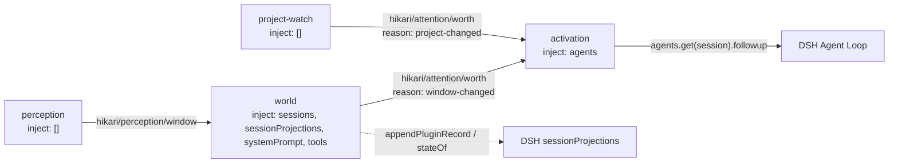
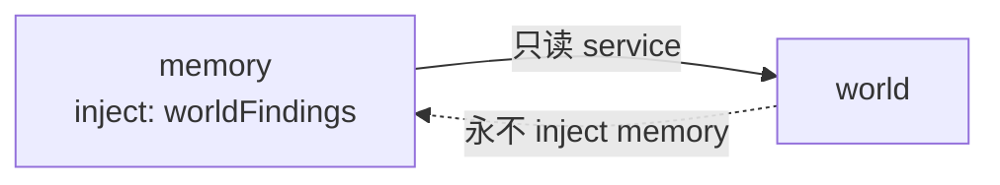

# Hikari 基础插件架构 v0.1

> 状态：**M0 已审阅通过（2026-10-30）**。架构方向 B1 成立；决策记录见 §10，待验证项见 §11。
> 本文档只冻结边界与契约方向，不含实现。
> 对应 HEAD `b4c4237`。源码引用行号以该提交为准。
> 素材：`experiments/m0-scope-facts.md`（现状事实表）、`experiments/m0-memory-world-options.md`（三方案比较）。

## 1. 现状：当前架构与模块边界

`hikari-native` 是**一个 npm 包、六个启用插件**，通过 bundle patch 挂进 DSH Profile，没有独立的 Runtime。

| 子路径 | `name` | 职责 | 是否启用 |
|---|---|---|---|
| `hikari-native/index.js` | `hikari-native-v0` | bundle 挂载点，`apply()` 为空（`:14-16`） | — |
| `perception/` | `hikari-perception` | 前台窗口观察，`inject: []`（`:11`） | ✔ `cordis.patch.yml:70-73` |
| `project-watch/` | `hikari-project-watch` | 项目状态采样，`inject: []`（`:22`） | ✔ `:92-100` |
| `world/` | `hikari-world` | 世界状态 + findings 状态机，`inject: ['sessions','sessionProjections','systemPrompt','tools']`（`:20`） | ✔ `:75-88` |
| `activation/` | `hikari-activation` | 把「值得处理」转成一次 follow-up，`inject: ['agents']`（`:11`） | ✔ `:102-105` |
| `project-status/` | `hikari-project-status` | `project_status` 工具，`inject: ['tools']`（`:22`） | ✔ `:63-67` |
| `scoped-fs/` | `hikari-scoped-fs` | 把 `read`/`glob`/`grep` 限制在仓库内，`inject: ['tools']`（`:23`） | ✔ `:54-59` |
| `replay/`、`trace/`、`readscope/`、`readscope-v2/`、`mutate/` | — | 实验遗留 | ✘（`replay` 显式 `disabled: true`，`:109-116`） |

**装配的唯一入口**是 `hikari-native/package.json:40-44` 的 `dsh.bundle.patch` 指向 `cordis.patch.yml`；profile 侧只有一个 `link:` 依赖（`dsh.profile.bundles = ["@deepseek-ai/dsh-base", "@deepseek-ai/dsh-web-app", "hikari-native-v0"]`）。**不存在重复挂载路径。**

两个 DSH 原生工具被替换：`tool-fs-search`（`:33-40`）与 `tool-fs`（`:42-51`）都 `disabled: true`，由 `scoped-fs` 的同名工具接管。

**一句话概括**：四个领域里，Perception 与 World 已存在，Activation 是「唤醒动作」而非领域实现，**Memory 尚不存在**。

## 2. 四域职责矩阵

| 领域 | 负责 | 明确不负责 | 持有状态 | 所有者 |
|---|---|---|---|---|
| **Perception** | 把外部信号变成一次事件（窗口标题、未来其他感知源） | 解释信号、判断重要性、决定是否唤醒 | 仅 `lastSignature`（去重用，`perception/index.js:67-79`） | Perception，内存，重启丢弃 |
| **World** | 维护「世界当前是什么样」+ 保存 Hikari 对世界结构的判断（findings） | 决定何时唤醒、决定是否回忆、执行动作 | 窗口世界态（内存，`world/index.js:54-63`）+ finding 记录（Session 日志投影，`world/findings.js:359-365`） | World |
| **Activation** | 收到「值得处理」后构造一次提示并投递 | 判断值不值得、修改世界、执行动作 | 无（`activation/index.js` 除 config 外无字段）；**事件队列语义未验证，见 §11** | 无状态（暂定，不冻结） |
| **Memory** | 保存**过去经历中值得未来重用的部分**，并提供检索 | 保存「世界现在是什么」、保存「Hikari 目前认为什么」（那是 World） | 长期记忆条目、生命周期、来源 | Memory（待建） |

**关键区分（任务书原话）**：Observation（世界发生了什么）/ Finding（Hikari 目前认为发生了什么 + 证据）/ Memory（哪些过去经历值得未来重用）是三个不同概念。

**Finding 是 World 的私有表示**，不是跨域共享的数据类型。其他插件可以引用它、查询它，不能复制它。

已核实的边界事实（详见素材文件 §3）：Perception 只产出事件不判断重要性；World 不拥有「值不值得打扰」的判断；Activation 只有一个注入点（`followup`，`activation/index.js:87`），不能凭空创建会话；Scoped-FS **只读**，无 `write`/`edit`。

**状态所有权核对（任务书的最高约束）**：跨重启保留的状态只有一类——finding 记录，载体是 Session 日志的 `plugin:hikari/finding` 记录，投影键 `hikari/world.findings`。全仓 grep 的结果：该键与 `plugin:hikari/finding` 只出现在 `world/findings.js`（定义 `:20-21`、注册 `:359`、读取 `:213`/`:267`）与 `world/index.js:13` 的注释里；`sessionProjections` 的引用也只在 World（`findings.js:359`、`:371`、`index.js:20`）。**没有第二个插件读写这份状态。** 其余状态（窗口世界态、`baseline`、`lastSignature`）全部在单插件内存里，重启即重建，不存在副本。

**这是现状，不是永久规则。** 长期原则只有一条：**World 对 Findings 负责，Memory 对自己的长期记忆负责，两者不重复持有同一份事实。** 「World 是唯一持久状态的领域」描述的是今天，Memory 一旦建成就会有它自己的持久状态——这不需要修改任何原则，只需要保证两份状态不重叠。

## 3. Capability 边界

**核心领域**（四域）：Perception、World、Activation、Memory。

**能力扩展**：按独立能力与权限边界各自建 Plugin，例如：

| 能力 | 例子 | 权限边界 |
|---|---|---|
| filesystem | 读文件、写文件、编辑 | 写权限必须显式声明，且受 scope 限制 |
| search | 仓库内搜索、文档检索 | 只读 |
| terminal / shell | 执行命令 | 最高权限，必须显式批准 |
| web | 请求外部网络 | 出站网络 |
| git | 提交、推送、分支 | 写操作 |
| notification | 通知用户 | 无副作用 |

**不做通用 Action Plugin**：不存在一个接受任意 `{type, payload}` 的「Action」插件去分发所有动作。每个能力自己的权限、自己的工具名、自己的失败语义。

**能力插件不持有领域状态**。terminal 插件不记得「上次跑了什么」是领域资产；git 插件不判断「这次提交值不值得记一条 finding」。能力只提供执行，意义由四域解释。

**今天已有的两个能力插件**：`project-status`（只读 git 查询，固定子命令、无 shell，`project-status/index.js:11-14`）与 `scoped-fs`（只读文件访问，`read`/`glob`/`grep`）。

## 4. Memory 与 World：三个方案

| 维度 | A 完全独立 | B1 统一入口 + 只读 Service | B2 统一入口 + 直读投影 | C 共享契约 |
|---|---|---|---|---|
| 模型看到几个检索工具 | 两组 | 一组 | 一组 | 两组 |
| 插件间新增 Service 依赖 | 无 | **有**（Memory → World 只读接口） | 无（但共享存储键） | 无 |
| 中央路由风险 | 无 | 中（分发者，非所有者） | 高（两个读者知道同一份存储） | 无 |
| 状态所有权清晰度 | 最高 | 高 | **低** | 最高 |
| 模型选择负担 | 高 | 低 | 低 | 高 |
| 新增来源是否改模型接口 | 改 | 不改 | 不改 | 改 |

**B2 必须排除**：Memory 直接 `inject ['sessionProjections']` 并读 `hikari/world.findings`，意味着两个插件同时依赖一个内部键，任何一方改结构都会静默破坏另一方。它是「不能偷偷复制并维护另一份事实」的结构版——复制的是结构知识而非数据，但后果相同。

**迁移风险（已取证）**：`@deepseek-ai/dsh-tools` 的 `register()`（`lib/index.js:2970-2979`）没有同名冲突检查，工具可见集用 Map 覆盖语义合成（`:3057`、`:3065`、`:3069`）。若 Memory 与 World 同时注册 `search_memory`，**谁后加载谁生效，没有警告**，胜负由 `cordis.patch.yml` 的插件顺序决定。

## 5. 推荐与理由

**推荐 B1。**

1. **接口稳定比零新增依赖更值钱**。A 与 C 让模型在两组工具间先判断「该问 findings 还是问历史」——那是工程认知。任务书把「是否回忆、读哪条、读多少」交给 LLM，但没把「入口选择」也交出去。
2. **新增来源不改模型可见面**。未来加 Session Episode、加跨项目记忆，只需在 Memory 内部加一个 provider，模型看到的仍是 `search_memory` / `read_memory`。
3. **所有权仍然单一**。World 拥有 finding 的状态与结构，Memory 只通过语义化只读接口问「有哪些匹配」。Memory 不知道 finding 存在哪个投影键。
4. **不需要新框架**。DSH 自己的 tools 服务就是 `class extends Service` + `super(ctx, 'tools')`（`dsh-tools/lib/index.js:1`、`:2756`、`:2794`），Hikari 用同一机制。

**「拥有入口」不等于「拥有数据」。** B1 常被误读成 Memory 变成记忆的总管，所以这一条要单独写死：

- Finding 仍由 World 创建、维护、改状态。
- Memory **不能修改** Finding，只能读。
- Memory 通过 World 的只读 Service 取 Finding。
- 未来的历史经历由 Memory 自己管理，不与 World 共享。
- 不做 Finding → Memory 的自动同步。

**Memory 也不是中央认知路由器。** 它只提供模型访问记忆的统一入口，**不决定模型应该回忆什么**。「是否回忆、读哪一条、读多少」仍然在模型手里（§8）。判断归她，入口归 Memory——两件事。

**四条硬约束**（B1 落地的前置条件）：

1. **工具名与参数不变**：`search_memory(query, limit, offset)`、`read_memory(id, offset, limit)`。变的是描述与结果集，描述里必须写明「包含两类来源」。
2. **World 侧注册可关**：`installFindings` 现在是硬注册（`world/findings.js:476-625`），要加开关，默认关，由 patch 显式开；且这个开关与 Memory 的接管必须在**同一次提交**里切换。
3. **只读接口不返回内部结构**：返回「记忆条目形态」，不返回 projection 里的原始 record。
4. **依赖方向单向**：World 的 `inject` 永远不出现 memory；加一条 grep 测试守住。

## 6. Service 与 Event 依赖图

现状（全部为事件，无插件间 service 依赖）：

**已核对的循环依赖**：六个插件的 `inject` 全部是 DSH 服务名（`tools` / `sessions` / `sessionProjections` / `systemPrompt` / `agents`），**Hikari 插件之间只走 `ctx.emit` / `ctx.on`，链路单向，无循环**。

B1 落地后新增一条**唯一的插件间 service 依赖**：

这是 Hikari 历史上第一条 Hikari→Hikari service 依赖。它必须满足：单向、只读、语义化、可 grep 验证。

## 7. Search / Read 迁移方案

**目标**：模型可见的工具名与参数不变，结果集从「只有 findings」扩展到「findings + 未来来源」。

**三阶段（每阶段可独立回滚）**：

| 阶段 | 动作 | 回滚方式 |
|---|---|---|
| M1-a | World 暴露只读接口（`world.findings.search/read`），**不接管任何工具** | 删除 service，工具调用路径原封不动 |
| M1-b | Memory 出现，**接管** `search_memory` / `read_memory` 的注册；World 侧开关关闭；同一提交完成 | 反向改开关 + 恢复 World 注册 |
| M1-c | 验证：同一 session 里两个工具来自 Memory，结果与 M1-a 前逐条一致 | 回 M1-a |

**兼容性**：

- **工具名与参数不变**：`search_memory(query, limit, offset)`、`read_memory(id, offset, limit)`。
- **返回结构不变**：`{ id, line, at, status, chars }` 与 `{ id, status, statusReading, evidence, ... }`（`findings.js:213`、`:267`）。
- **历史 Session 只读**：finding 记录已写在日志里，投影键 `hikari/world.findings` 不变，读出来照旧；**不迁移、不重写、不重建**。
- **分页：对外契约固定，底层语义不泄漏。** 对模型暴露的始终是 `offset` / `nextOffset`（`findings.js:213` 今天就在用这套），**不收时间游标、不收快照 token**。findings 内部按行号偏移、未来 history 内部按时间游标，这层差异由 Memory 的适配层吸收——模型不需要知道底层来源怎么翻页。**不承诺快照一致性**：两次分页之间若底层有新记录写入，允许出现漏条或重条，这与今天的 `searchFindings` 行为一致。M1 只有 findings 一个来源，适配层是恒等映射；M2 接入第二个来源时，模型可见接口不变。

## 8. Memory Plugin 的最小职责

**必须持有**：长期记忆条目、生命周期（何时失效）、来源追溯（这条记忆从哪来）。

**不持有**：finding 状态（World）、世界当前态（World）、会话原始文本（Session 日志，只读）。

**必须由 LLM 决定**：是否回忆、读哪一条、读多少。

**必须由工程层保证**：

- 写入原子性（参考 World 的 `recordQueue` 串行化，`findings.js:117`）
- 来源可追溯（每条记忆能指回产生它的那次经历）
- 状态转换合法性（World 的 `TRANSITIONS` 表是现成范例，`findings.js:51-56`）
- 预算（条数上限、字符上限——`findings.js:24-25` 的 `MAX_CONTEXT_FINDINGS=3` / `MAX_CONTEXT_CHARS=1200` 是同一类约束）
- 权限（能读什么、不能读什么）

**M1 只做骨架**：能加载、能读配置、有生命周期、暴露 service 契约、有基础测试。**不做检索算法、不做持久化、不做写入。**

## 9. 实施阶段与测试计划

| 阶段 | 目标 | 关键测试点 |
|---|---|---|
| **M0** Memory 架构设计 | 冻结四域边界与 Memory/World 关系 | ✔ 已完成（本文档） |
| **M1** Memory Retrieval | 把 `search_memory` / `read_memory` 的**工具入口**迁到 Memory；World 暴露只读 Findings Service；保持现有搜索与读取行为；**不新增任何记忆存储** | ①用真实 findings 数据验证迁移前后结果逐条一致；②工具注册表唯一提供者（CI）；③插件加载后 service 可用；④配置非法 fail-closed；⑤卸载时 service 与订阅全部释放（参考 PoC-04 级联清理读数）；⑥同名工具覆盖有测试兜底 |
| **M2** Memory Persistence | 建设真正属于 Memory 的历史记忆：存储、写入、形成条件、来源追溯、生命周期 | ①写入原子性与去重；②时间与有效期读写；③来源链路可回溯；④跨重启后条目仍在；⑤分页适配层在多来源下不跳条；⑥预算超限时截断而非报错 |
| **M3** Memory Integration | 验证 Perception / World / Activation / Memory 协作 | ①同一次唤醒里 Memory 与 World 都能被查；②两类来源混排时描述清楚；③不出现两份事实；④观察她能否自主决定何时回忆 |
| **M4** 四插件整体审阅 | 审查四个基础插件的职责、数据所有权、Service/Event 契约、运行边界 | 不是测试阶段，是架构审阅 |

**M1 明确不做的事**（写得比「做什么」更重要）：不接 Session Episode、不接灵枢、不做向量检索、不做自动记忆同步、不建数据库、不改 `search_memory` 的结果集范围。

**M1 的验收必须包含两条硬检查**：

1. **负向测试**：故意让 Memory 与 World 同时注册 `search_memory`，断言系统**不会**静默换掉实现——要么明确报冲突，要么由开关保证只有一个注册者。
2. **CI 检查**：导出最终工具注册表，断言**每个工具名只有一个提供者**。这条检查要能拦住「加载顺序决定实现」的情况，而不是依赖人工核对 `cordis.patch.yml`。

## 10. 决策记录（M0 审阅结论）

| 决策项 | 结论 |
|---|---|
| Memory 架构 | **B1**——Memory 做统一检索入口，World 以只读 Service 提供 Findings |
| World 工具开关 | **默认关闭**；未接 Memory 的旧 Profile 显式开启；切换必须在同一提交完成 |
| 普通记忆写入 | **模型自主决定**，不逐次批准 |
| 敏感记忆 | **不默认长期保存**，必要时征求同意 |
| 删除长期记忆 | **需要明确授权** |
| 跨项目扩大记忆范围 | 遵循明确授权 |
| M1 数据来源 | **仅 Findings**，不接 Episode / 灵枢 / 向量 |
| 自动 Finding → Memory 同步 | **不做**（必须由模型主动决定写入） |
| 插件依赖 | **Memory → World，只读，单向** |
| 分页 | **保持统一对外契约**（`offset` / `nextOffset`），底层语义不泄漏 |
| Activation 无状态 | **暂不冻结**，补验证（§11） |

**记忆写入的分级策略**：

| 情况 | 处理方式 |
|---|---|
| 普通项目事实 | 模型自主写入 |
| 有明确证据的长期认识 | 模型自主写入 |
| 不确定的信息 | 可以先询问用户 |
| 涉及个人敏感信息 | 不默认长期保存，必要时征求同意 |
| 跨项目扩大记忆范围 | 遵循明确授权 |
| 删除长期记忆 | 需要明确授权 |

**仍需裁决（不影响 M1 开工）**：

1. **要不要拆成独立 npm 包**——用户提到的长期目标是「四个拥有明确职责、能独立演进的插件」，但拆包是发布层的事。当前单包多子路径（`package.json:7-22`）加 `memory/` 即可，拆包留到确实需要独立版本节奏时。**倾向不拆。**
2. **findings 与 memory 是否允许模型交叉引用**——检索时若一条 finding 与一条 memory 相关，要不要互相提示存在？M1 阶段没有第二来源，可以搁置到 M2。

## 11. 待验证项：Activation 是否真的无状态

源码里 `activation/index.js` 除 config 外没有字段，所以「无状态」**在这个提交上是事实**。但这不等于它在语义上应该无状态——事件投递的队列行为还没验证过，而 `u-sxrkfw`（一次 emit 没有对应 turn）正是这条怀疑的入口。

四个必须先回答的问题：

| 问题 | 为什么重要 | 当前已知 |
|---|---|---|
| 正在执行 Turn 时发生的新事件会不会丢失？ | 若会丢，Activation 需要在投递失败时保留事件 | 未验证 |
| 多个事件能否正确合并？ | 若不能，一次密集变化会连续唤醒多次 | 未验证 |
| 冷却期间的事件如何处理？ | 若直接丢弃，可能丢掉真正的状态跃迁 | 未验证 |
| 重启时尚未处理的事件是否有恢复机制？ | 若没有，跨重启的唤醒不可靠 | 未验证 |

**这不影响 M1。** 但它决定了 M4 整体审阅时 Activation 的边界怎么定——现在写「Activation 无状态」是描述，不是约束。
