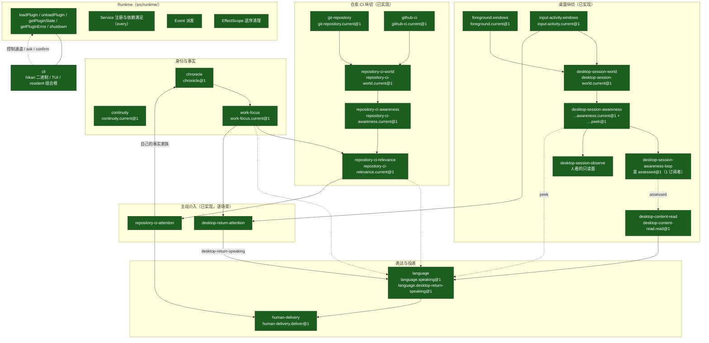

# Hikari 当前架构（Current Architecture）

> **关于本文中指向 `docs/development/current-stage.md` 的行号**：该文件会被持续在文首追加状态行，**它的行号会漂移**——同一份文件里今天同时存在 +8、+84、+1441 等不同偏移，取决于每条引用写下的时间。**本文里的行号是写作当时的位置，不是今天的位置。** 要按今天读，请拿引号里的原文或小节标题去搜那个文件。
>
> 这条限定按 `governance-rules-v1.md` R7.2 加：**正文一个字符都没有改**，只在文首留一条说明，免得读者以为断掉的指针是我们今天写错的。

> **状态**：当前状态的**入口与总览**。描述的是**这个工作区今天实际是什么**，以 `src/`、`test/`、`package.json` 的实测为准。
>
> **权威**：本文**不产生 MUST**，**不取代** `principles.md`、`core-architecture-v0.md`、`plugin-design-spec.md`、`governance-rules-v1.md` 中的任何一条。本文与它们冲突时**以它们为准**，并把冲突记录在 §12。
>
> **配套**：`docs/vision/hikari-long-term.md` 说的是「打算成为什么」；**本文说的是「今天是什么」**。两份必须分开读。
>
> **证据基准**：本文写于 commit `ada401c`（当时工作区领先 `origin/main` 11 个提交）。所有 `file:line` 引用以该 commit 为准；行号会漂移，**条目名与路径才是身份**（`governance-rules-v1.md` R7.4）。
>
> **全量重测（2026-10-13，`41adccd`）**：§0–§14 的可核对断言已由**五个独立核对面**（按节切分）逐条对照 HEAD 复核。**每一处纠正都在原地标了「订正 / 重测（`41adccd`）」并附证据，没有静默改写。** 改动集中在四类：
>
> 1. **计数**：19 个 Plugin——**判据改为「产出 `PluginDefinition` 值」**（按「目录里有 `plugin.ts`」会数出 20，因为 `runtime/plugin.ts` 定义的是机制、没有任何值）；17 个 Service 契约；1 个 Event 契约但**订阅者 0 → 1**；base **十**成员；合法 roster **六**条。
> 2. **我自己在上一轮写错的两处**：把 `desktop-content-read` 说成「可选的领域插件」——它是**无条件加载的 base 成员**。
> 3. **原文自己的三处错**：插件上下文的 API 多写了三个方法（`has` / `isProvidedBy` / `subscribe` 都不在上下文上）；一条列了**三条**却写「两条」；Human Surface 的 outcome 词写成四个（协议是五个）。
> 4. **一批已过期的否定性断言**与图：「权限 / 授权层无」「第二类判据无」「Event 订阅者 0」「CI 从未运行过这些提交」——**全部不再成立**；关系图缺 `desktop-content-read` 节点、并仍标着「0 订阅者」。
>
> **仍未做，如实标出**：`§7.3`（Grounded Synthesis 的七条）整节已明显过期，本轮只加了该节标记与要点更正，**未重写**；`§12.1` 与 `§11.9` 里 `current-stage.md` 的行号仍按 `81504db` 时点，已就地说明漂移量（+8）。

---

## 0. 一句话现状

Hikari 今天是一个**很薄的运行生命结构 + 两条纵向感知链 + 一条由人授权触发的桌面正文读取链 + 一个语言出口 + 两个主动介入场景**。

```text
有一个 Runtime（只懂 Plugin / Service / Event / cleanup）
有 19 个 Plugin（17 个 Service 契约、1 个 Event 契约，且那个 Event 现在有 1 个生产订阅者）
有一条身份生命线（Continuity）和一条事实生命线（Chronicle）
有两套「感知 → World → Awareness」纵切（桌面、仓库 CI）
有一个模型出口（Language，带原生 tool use）
有两处主动说话（回到座位、CI 失败）
有四个面向人的入口（CLI / TUI / Human Surface / subscribe）
没有任何一条真实副作用经过统一治理链 —— 因为今天也没有需要治理的副作用
```

**没有** Memory、Goal、Action Pipeline、Planner、Tool Registry、权限层。这些不是「未完成」，而是**今天不存在**（§10 给出实测依据）。

---

## 1. 真实模块关系



图例：**深绿** = 已实现并验证；**深黄** = 存在但有一处未闭合（**今天没有节点属于这一类**——上一版标黄的正是 `desktop-session-awareness-loop` 的 `assessed@1`，而它在 G-1 轮拿到了第一个订阅者，见 §3.2）；**紫虚框** = 今天不存在。

> 这张图**不包含** Memory、Goal、Action、Judgement、Planner、Tool Registry —— 因为它们在 `src/` 里**没有任何对应物**（§10）。

---

## 2. Runtime 与 Plugin 结构

### 2.1 Plugin 只有一种

`PluginDefinition<TConfig>` = `{ id, version, requires?, provides?, config?, setup }` —— `src/runtime/plugin.ts:29-36`。

`src/` 下 22 个目录里，**19 个产出 `PluginDefinition` 值**。判据是「产出那个值」，**不是「目录里有 `plugin.ts`」**——按后者会数出 20，因为 `runtime/plugin.ts` 定义的是 Plugin 的**机制**（`PluginState` / `PluginServiceContext` / `PluginContext` / `PluginDefinition` 等，8 个 export 全是 `export type` 或 `export interface`，**没有任何值**），Runtime 本身不是 Plugin。另外两个不是插件模块：`cli/`（宿主入口）、`terminal-text/`（终端文本小工具）。**（重测于 `41adccd`；`ada401c` 时是 21 / 18。）**

**没有** `AgentPlugin` / `SensorPlugin` / `LoopPlugin` 这类业务基类树。「Loop」「Perception」「World」「Awareness」「Attention」在今天的代码里都只是**领域角色**，不是 Runtime 概念。

### 2.2 生命周期与依赖

```text
loadPlugin → waiting（requires 未满足）
           → active（#requirementsSatisfied：requires 的 every）
           → stopping → 卸载（EffectScope 逆序清理）
           → failed（启动或运行中抛出）
```

`#requirementsSatisfied` 是一个 **`every`** —— 这带来一个今天真实存在的后果：**require 了一个没人提供的契约的 Plugin 会永远停在 `waiting`**。这正是今天用「组合 roster」而不是「optional requires」来区分语言 variant 的原因（`baseLanguageVariant` 与 `repositoryLanguageVariant`，`src/language/plugin.ts`）。**按符号引用，不按行号**——原文引的 `:484` / `:531` 已漂到别处（`governance-rules-v1.md` R7.4「行号不是身份」）。

### 2.3 公开 API

`Runtime` 类只有五个方法（`src/runtime/runtime.ts`）：

| 方法 | 行 | 作用 |
| --- | --- | --- |
| `loadPlugin(definition, config?)` | `:31` | 注册并启动 |
| `unloadPlugin(id)` | `:61` | 卸载单个 |
| `getPluginState(id)` | `:70` | `waiting | starting | active | stopping | failed` |
| `getPluginError(id)` | `:74` | 该 Plugin 的最后一个错误 |
| `shutdown()` | `:78` | 逆序全部释放 |

Plugin 侧上下文其实**只有四个方法**：`services.get` / `services.provide`（`src/runtime/plugin.ts` 的 `PluginServiceContext`）与 `events.on` / `events.emit`（同文件的 `PluginEventContext`）。**订正**：上一版写的是 `services.has / isProvidedBy` 与 `events.subscribe` —— 那三个**不在插件上下文上**，插件拿不到；它们是 Runtime 内部类的方法（`has` / `isProvidedBy` 在 `ServiceRegistry`、`subscribe` 在 `EventBus`）。

**三条真实的强制**（不是约定，是抛错）——上一版写「两条」，但下面本来就列了三条：

- `services.get` 一个**没有写进 `requires`** 的契约 → `UndeclaredServiceDependencyError`（`src/runtime/plugin-context.ts`）。这是「Consumer 只能拿自己声明过的东西」在代码里的落点。
- `services.provide` 一个**没有写进 `provides`** 的契约 → `UndeclaredServiceProviderError`。
- `events.emit` 时任一订阅者抛出 → 以 `AggregateError` 失败。

### 2.4 今天没有的 Runtime 机制

无 optional requirement、无动态发现、无 service locator、无配置热重载、无插件重试（`failed` 不自动重试）、无任务取消框架、无跨进程 Service。

---

## 3. Service 与 Event 平面

### 3.1 Service：今天恰好 17 个

每个都是 `defineService<T>(id, version=1)`（`src/runtime/contracts.ts:16`），运行时 key 是 `` `${id}@${version}` ``（`:28`）。

| 契约 id | 提供者 | 契约文件 |
| --- | --- | --- |
| `chronicle` | `chronicle` | `src/chronicle/contracts.ts:10` |
| `continuity.current` | `continuity` | `src/continuity/contracts.ts:8` |
| `foreground.current` | `foreground.windows` | `src/foreground/contracts.ts:8` |
| `input-activity.current` | `input-activity.windows` | `src/input-activity/contracts.ts:8` |
| `git-repository.current` | `git-repository` | `src/git-repository/contracts.ts:11` |
| `github-ci.current` | `github-ci` | `src/github-ci/contracts.ts:12` |
| `human-delivery.deliver` | `human-delivery` | `src/human-delivery/contracts.ts:46` |
| `work-focus.current` | `work-focus` | `src/work-focus/contracts.ts:30` |
| `desktop-session-world.current` | `desktop-session-world` | `src/desktop-session-world/contracts.ts:8` |
| `desktop-session-awareness.current` | `desktop-session-awareness` | `src/desktop-session-awareness/contracts.ts:49` |
| `desktop-session-awareness.peek` | `desktop-session-awareness` | `src/desktop-session-awareness/contracts.ts:83` |
| `repository-ci-world.current` | `repository-ci-world` | `src/repository-ci-world/contracts.ts:13` |
| `repository-ci-awareness.current` | `repository-ci-awareness` | `src/repository-ci-awareness/contracts.ts:13` |
| `repository-ci-relevance.current` | `repository-ci-relevance` | `src/repository-ci-relevance/contracts.ts:47` |
| `language.speaking` | `language` | `src/language/contracts.ts:72` |
| `language.desktop-return-speaking` | `language` | `src/language/contracts.ts:96` |
| `desktop-content-read.read` | `desktop-content-read` | `src/desktop-content-read/contracts.ts:70` |

**重测（`41adccd`）**：末行那条是 G-1 轮新增的。**它不属于「可选」那一类**——上一版这里写「只在组合里显式启用时才在」，那是推断，不是实测：`desktop-content-read` 是**无条件加载的 base 成员**（`src/cli/resident.ts:288-291`；`test/resident-cli.test.mjs:89-100` 的 `BASE_MEMBER_IDS` 十项里它排第 9，注释逐字写着它「joined the base … rather than being an optional capability like everything appended below」）。可配置性从来不是它进组合的条件——**它不需要模型、不需要 repository、不需要 mandate**，因为它读的就是 awareness loop 已经采样过的那个窗口。其余 16 条与 `ada401c` 时相同（行号可能漂移）。

这 17 个数字是**今天的事实**，不是架构不变量。Runtime 不知道它们是什么。

### 3.2 Event：今天恰好 1 个，生产订阅者 1

```text
desktop-session-awareness-loop.assessed@1
  声明  src/desktop-session-awareness-loop/contracts.ts:12
  发布  src/desktop-session-awareness-loop/plugin.ts:85
  订阅  src/desktop-content-read/plugin.ts:200（唯一的生产订阅者，G-1 轮加入）
```

**本节在 `ada401c` 时写的是「生产订阅者 0」。** 那句当时是真的；`src/cli/resident.ts:197-200` 现在逐字记录它不再成立：「This comment used to say that `desktop-session-awareness-loop.assessed` has zero subscribers in production, and that is no longer true: `desktop-content-read` subscribes to it, and is the only thing that does.」

**订正（`41adccd`）**：上一版这里写「那个订阅者是一个**可选的**领域插件」——**是错的**，那是从「新加的、领域插件」推出来的，不是实测。它是 **base 成员，无条件加载**（`src/cli/resident.ts:288-291`）。所以「有没有订阅者」在今天的默认组合里**是一个常量**：恰好一个，且写死在 base 里。

这比原来的说法更值得记，因为两件事因此变了性质：这条 Event 已经从「有生产者、没有语义消费者」变成**组合里的一条真实依赖边**；而「谁订阅了它」不再取决于启动参数。

ESLint 式的「Event 误用」（用 Event 做查询、做请求/响应、做命令）今天仍然没有发生，但理由变了：不再是「只有一个 Event 且无人订阅」，而是只有一个 Event、恰好一个订阅者，且它只承载「刚刚发生了一次评估」。

---

## 4. Chronicle、Continuity 与今天落盘的东西

### 4.1 今天只有三处代码写盘

| 内容 | 路径 | 写入方式 | 源码 |
| --- | --- | --- | --- |
| 身份原点 | `<dataDir>/continuity/origin.json` | 临时文件 + `renameSync` 原子替换 | `src/continuity/storage.ts:14-16, :31, :39, :48` |
| 长期事实 | `<dataDir>/chronicle/chronicle.jsonl` | 第一行是 Store Header `{ kind:'hikari-chronicle', version:1 }`，其后每行一个 `DurableFact` | `src/chronicle/store.ts:24-36, :104-119` |
| 启动 profile | `<dataDir>/launch.json` | 整体覆盖 / 删除 | `src/cli/launch-profile.ts:27-29, :57, :63` |

`DurableFact` = `{ factId, type, version, occurredAt, recordedAt, source, payload }`（`src/chronicle/fact.ts`）。

### 4.2 今天存在的事实家族（三个）

```text
repository-ci-attention.delivered   src/repository-ci-attention/facts.ts:40
    source kind: repository-ci-attention.delivery   :51
    dedupe key:  `${repository}#${runId}`           :73

language.decision-confirmed         src/language/continuity.ts:64
    source kind: language.endpoint   :76
    只由 CLI 的 confirm 命令写入     :255

work-focus 自己的家族                src/work-focus/facts.ts
```

**端点地址不落盘。** 每个命名管道都由 canonical dataDir 的 sha256 前 16 位推导，且非 win32 一律 `undefined`；没有任何地址文件（`src/cli/control.ts:42,66`；各 Plugin 的 `endpoint-path.ts`）。

### 4.3 今天已经成立的语义

- **`hikari init` 与 `hikari chronicle init` 是显式创建**；`hikari start` 与 `hikari resident` 是**零创建**路径（`src/cli/init.ts`、`src/cli/chronicle-init.ts`、`src/cli/start.ts`、`src/cli/resident.ts`）。
- **没有 `openOrCreate`**。读取是纯读取。
- **动作成功不以写事实为条件**（`durable-fact-admission-v0.md` §4）：`src/work-focus/session.ts` 在 append 失败时 catch 掉，照样返回 `ok`，另附一句 UNCONFIRMED。
  **订正（`41adccd`）**：原文还写了对称的前半句「写事实不以动作成功为条件」——**那一半是错的**，至少对 `repository-ci-attention` 明显相反：它的 `delivered` 家族**只在 `deliver` 答 `delivered` 的那一支里写**，所以「这条事实存在」本身就是「投递成功」的断言（`src/repository-ci-attention/facts.ts:35-36` 逐字：「the only code that writes one is the branch where `deliver` answered `delivered`」）。准确的表述是：**写不写由每个家族自己定**——CI 那条以投递成功为条件，work-focus 那条以「集合真的动了」为条件（语义无操作不写）；两者都与 append 是否取得持久化确认无关。
- **一个事实家族只有一个写入者。** 今天没有任何通用 recorder。

---

## 5. Resident 与人的入口

### 5.1 CLI 命令面

`hikari`（`bin` → `dist/cli/main.js`，`package.json:5-7`），分派表 `src/cli/main.ts:44-76`：

```text
hikari                              打开 TUI（唯一路径；`hikari tui` 被拒绝，src/cli/options.ts:276）
hikari init  --data-dir <path>      写身份原点
hikari chronicle init --data-dir    建事实存储
hikari start --data-dir             组合并运行（前台，零创建）
hikari resident --data-dir ...      常驻
hikari status --data-dir            向常驻问状态
hikari stop --data-dir              请常驻停机
hikari subscribe --data-dir         流式读 Hikari 投递出来的消息
hikari focus declare|replace|clear|status
hikari relevance repository-ci status
hikari observe desktop-session status
hikari ask --data-dir "<text>"
hikari confirm --data-dir "<text>"
hikari screen --data-dir "<text>"   一个词授权一次窗口读取，再按页面上实际有的材料回答
hikari content status --data-dir    问运行中的常驻：它上次看到的那个窗口里有什么
hikari profile set|show|clear
```

**`status` / `stop` / `subscribe` / `focus` / `relevance` / `observe` / `ask` / `confirm` / `screen` / `content status` 都经命名管道到达运行中的常驻**（**补充于 `41adccd`**：`screen` 与 `content status` 是这一轮新增的两条，原文只列了前八条），因此在非 Windows 上无法工作（各 `endpoint-path.ts` 在非 win32 返回 `undefined`）。

### 5.2 常驻组合

`src/cli/resident.ts` 是组合根（`productionComposition`）。默认 rosters 与追加轴（`--repository-root` / `--repository` / `--model`）被记录为**合法 roster 共享同一个基础前缀**；`judgement-reachability-v0.md` §5 明确写下：

> 「九个」仍然不是架构不变量。

**重测（`41adccd`）**：两个数字都变了——**base 现在是十个成员**，`desktop-content-read` 是第 9 个且**无条件加载**（`test/resident-cli.test.mjs` 的 `BASE_MEMBER_IDS` 十项，注释逐字「Ten members, and the tenth is the newest」）；**合法 roster 是六条**（同一测试文件：「六个 roster 共享同一个基础前缀，且共有成员保持相对顺序」）。原文的「四条 roster」与引文里的「九个」都停在 `ada401c`。

**那句不变量仍然成立，而且这次数字变动正是它的证据**：被钉住的是「每条合法组合各自」，不是某个成员数。把它当成计数来读，就会像原文那样在下一个成员到来时过期一次。

`ready` 的语义是「组合里的 Plugin 全部 active」（`src/cli/resident.ts`）。它**不等于**第一次 assessment 成功、不等于后台链路健康、不等于后续每次获取都会成功 —— `current-stage.md` 已把这条限制记为 v1 已知限制（后台 cycle 失败没有公开健康表面）。

### 5.3 控制通道

一个版本、两个词、封闭：`status` 与 `stop`。端点名由 canonical dataDir 推导，一个数据目录一个端点。

**能问、能停 ≠ 可运维**：没有 log、没有 daemon 化、没有自动重启、没有 watchdog、没有 pid 文件、没有配置重载、没有健康检查、没有任何身份认证、没有远程控制面。

### 5.4 TUI

`hikari` 无命令即进入 TUI（`src/cli/tui.ts`、`src/cli/tui-render.ts`、`src/cli/tui-state.ts`、`src/cli/tui-input.ts`）。三个视图 Chat / System / Profile，`Tab` 循环；TUI 内的 `/start` `/stop` `/restart` 是**终端内的动作**，不是 CLI 子命令（`src/cli/tui.ts:593,614,618`）。

已经冻结并且今天仍然成立的四条边界（`docs/architecture/hikari-tui-v1-implementation-boundary-freeze.md`）：

```text
统一的是 UI，不是协议（:62）—— 复用既有三个 endpoint，不建 Unified Backend / central router
不把 status 行读成 Plugin 语义 —— 禁止正则反解析，避免第二套状态模型（:126）
transcript 是进程内、有界、不落盘的，且不叫 Memory / Conversation History / Chronicle（:140,:144）
Human Delivery 仍是 single subscriber，TUI 不抢、不踢、不要求 fan-out（:154）
```

用户可见的历史事实：**`hikari console` 已不再是命令**（现在是未知命令，退出码 2）。

一条今天已经被实测钉住的渲染事实（本轮 Grounded Synthesis 修订所确立，写入 `src/language/express.ts` 头注释与 `test/language.test.mjs`）：

> `clip` 在**行宽 ≤ columns 时整行保留**；为裁剪标记留的那一列只有在**真的发生裁剪**时才花掉。

### 5.5 Human Surface（今天唯一的图形入口，且不在 `src/` 里）

`apps/human-surface/` 是一个 .NET 8 WinForms 程序（framework-dependent，零 NuGet），三个工程：`HumanSurface/`、`HumanSurface.Core/`、`HumanSurface.Tests/`。它**不是 Runtime Plugin**，Runtime 与 `src/` 对它零依赖。

```text
出站：连到既有的 human-delivery 命名管道，托盘 + 一个窗口显示 Hikari 主动送达的消息
入站：HUMAN SURFACE LANGUAGE CLIENT v0 之后，它直接成为既有 Language endpoint 的 client
```

已经冻结的性质：

- **它没有第二条协议。** 管道名、framing、**五个** outcome 词（`chatted | answered | recorded | refused | failed`）全部**镜像** Language 侧 owner（`src/language/protocol.ts`、`src/language/endpoint-path.ts`、`src/cli/language.ts`——最后一个在 `a2d701f` 由 `src/cli/ask.ts` 改名而来）；C# 侧只是 client。**订正（`41adccd`）**：上一版写「四个 outcome 词」——**那句话在 HEAD 之前就是错的**：协议早已有第五个词 `recorded`，而 C# 侧一直只认得四个，于是把一个合法应答报成 unreadable。两侧现在都是五个，且 conformance 的应答语料已由四种 shape 补成五种（`apps/human-surface/HumanSurface.Tests/node-helpers/conformance.mjs`）。
- **它不是 judgement owner。** 不做显著性/重要性/是否该通知的判断，不读 repository / input activity / Work Focus，不订阅任何 domain plugin，不调模型。
- **它不 durable。** 消息列表 `durability = none`，不落盘、不写 Chronicle。
- **reconnect ≠ message retry**：重连是 transport availability，不是 delivery guarantee。
- **「退出」只退出 Surface**，不调 `hikari stop`，不碰 Resident。

`docs/architecture/human-surface-v0-implementation-boundary-freeze.md` §12 的第一条（「不做 Human → Hikari 对话」）已被 `human-surface-language-client-v0-implementation-boundary-freeze.md` 解除；原文按 R7.2 **保留不改**，两份文档之间已有双向指针。

**这个门禁自 `a2d701f` 起失效过，已在 C# CONFORMANCE GATE RESTORATION 修复。** 上面那句「C# 会红，而不是静默漂移」的前提曾随改名消失：C# 侧探的 `dist/cli/ask.js` 不再存在，该前提是**四个测试类共用**的，因此**17 个用例全部 skip**（`DeliveryEndpointPathTests` 3 + `LanguageConformanceTests` 6 + `LivePipeTests` 4 + `LiveLanguageTests` 4），而 skip 不算失败。今天的探测常量与 helper 的 import 都指向 `dist/cli/language.js`，本机实测 `69 passed, 0 failed, 0 skipped`。**订正（`41adccd`）**：原文接着写「这条修复尚未经过 CI：本地领先 `origin/main`（`5dc1bc1`）十三个提交，CI 在 `a2d701f` 及其后的每一个提交上都是 0 次运行」——**两句都已不成立**：`git rev-list --count origin/main..HEAD` 现在是 **0**，`origin/main` 就是本文的证据基准 `41adccd`，`gh run list` 在 `9db8d34` 起的各个推送头上都是 `completed / success`。**仍然要如实说的**：`a2d701f` / `3b406fd` / `81504db` 三个提交本身没有运行记录——它们从未成为一次推送的头；CI 按推送头跑，所以「某个提交没有运行」**不等于**「那棵树没被测过」。失效期的实测与后果见 §11.7，死路径引用的完整清单见 §12.1 第 9 行。

---

## 6. 感知 → World → Awareness：两套纵切

### 6.1 桌面纵切

```text
foreground.windows       看见前台窗口        src/foreground/plugin.ts:10
input-activity.windows   看见有没有输入      src/input-activity/plugin.ts:11
        ↓ 两个 facet 合并
desktop-session-world    一个 snapshot        src/desktop-session-world/plugin.ts:11
        ↓
desktop-session-awareness  overlay            src/desktop-session-awareness/plugin.ts:64
        ├→ …current@1   给需要「当前判断」的消费者
        ├→ …peek@1      给只想知道「跟上次比变了没有」的消费者，不做赋值
        ├→ desktop-session-awareness-loop（定时评估，发 assessed@1）
        └→ desktop-session-observe（人看的只读面）
```

已经成立的语义（来自 P3 各轮，落点在源码与 `current-stage.md`）：

- **缺席是一次观测**（`available + absent`），**取不到不是缺席**，**未知不得塌缩成缺席**。
- World 是 **composer，不是 interpreter**：它合并不解释。
- `current()` **永不 reject**：失败以 `unavailable` 表达。
- Awareness overlay 只做**上下文对比**，`stable` 是**关于观测值的陈述，不是关于世界的陈述**。

`peek@1` 的存在值得单独读：它说明今天已经出现了「同一个数据、两种消费语义」的真实需求 —— 一种要基线做对比，一种只读不改 —— 而处理方式是**加一个契约，不是给消费者加开关**。

### 6.2 仓库 CI 纵切

```text
git-repository   本地工作树/HEAD     src/git-repository/plugin.ts:19
github-ci        Actions run（HTTP） src/github-ci/plugin.ts:24
        ↓
repository-ci-world        src/repository-ci-world/plugin.ts:20
        ↓
repository-ci-awareness    src/repository-ci-awareness/plugin.ts:37
        ↓  + work-focus.current
repository-ci-relevance    src/repository-ci-relevance/plugin.ts:43
```

`repository-ci-relevance` 是今天唯一一个把**两样东西合起来判断**的 Plugin（CI 变化 × 已声明的工作焦点），而它的判断规则**只有一条**：逐字相等，取值只有 `relevant | unknown`。这是被有意冻结的 v1，不是没来得及做。

### 6.3 神经系统今天的真实进度

「神经系统」**不是一个组件，是一个阶段视角**（`docs/architecture/hikari-nervous-system-stage-v0.md:60-61`：它描述「感知 → 形成经历 → 留下影响 → 后来被重新唤起」这一层系统行为，不是要建立的子系统）。今天它的**载体**是：

```text
4 个感知 Plugin（foreground / input-activity / git-repository / github-ci）
1 个正文读取（desktop-content-read）——**不是第五个感知 Plugin**：requires 为空、
  只 provides 一个读服务、没有自己的 World、没有 overlay；它读的是 awareness
  loop 已经采样过的那个窗口（G-1 轮加入，base 成员）
2 个 World（desktop-session-world / repository-ci-world）
2 个 Awareness（desktop-session-awareness / repository-ci-awareness）
1 个 Loop（desktop-session-awareness-loop，每 activation 至多一个 cycle in-flight，不重叠）
```

**它不是 Central Brain，也没有一处代码叫「神经系统」。** 没有统一判据、没有优先级、没有跨 source 推断。

该阶段文档自己给出了**完成判据，且今天没有达到**（`:182-184`）：

> 本阶段**不能**以「建立了 X」判定完成。**1. 读侧不再为零。** 至少有一个生产 Plugin 读取**它自己的**过去，并因此行为不同。

今天读侧与写侧的实测（逐条 grep，不是推断）：

```text
chronicle.append    work-focus/session.ts:81
                    repository-ci-attention/plugin.ts:215
                    language/plugin.ts:326

chronicle.read()    repository-ci-attention/plugin.ts:161  读回「我自己投递过哪些提醒」
                    language/plugin.ts:403                 读回「已确认的决定」

chronicle.get()     生产调用者 0

experience / concern / salience 三个词在 src/ 里的**符号**命中数：0
  —— **订正（`41adccd`）**：原文写「命中数：0」，实测**注释命中 17 处**（符号仍然是 0）。
     例：`src/language/model.ts`「a language concern, and this is where that concern lives」；
     `src/desktop-content-read/plugin.ts`「No Memory, no Experience, no store, no file」。
     这个区别要紧：命中为 0 会被读成「这些词在仓库里不存在」，而真相是
     「它们只出现在否认式的注释里」——后者才是可引用的证据。
```

**一个必须说清楚的后果**：按阶段文档 §4（`:182-186`）的完成判据第 1 条 —— 「**至少有一个生产 Plugin 读取它自己的过去，并因此行为不同**」——`repository-ci-attention` 今天**字面上符合**：它读回自己私有的 `delivered` 家族，并因此**不重复播报**。而同一份文档在 §2C 下的注（2026-10-08）主张这不构成 Reactivation 的解冻，理由是「**一个 owner 读自己私有的 fact 家族**……不是『当前情境与过去产生关联』」。

**两句指向的不是同一件事**（§4 判完成，§2C 判 Reactivation 语义），因此**本文不替它定性**：判据第 1 条是否已经达到，是一次 Human/作者的裁决（§13 **第 7 行**）。**订正（`41adccd`）**：原文写「§13 第 9 项」——§13 只有 7 行，那个编号是重编号之前的残迹。

该阶段的第一份研究是 `docs/architecture/experience-formation-v0-research.md`，其结论是 `VERDICT = NARROW`（`:526`），核心判断是：

> **一条写了但没被读过的 Experience，与一条 Durable Fact 无法区分。因此 Experience Formation 不是一个存储问题，是一个「谁读自己的过去」的问题。**（`:436-437`）

该阶段的 §5（`:198`）明确不解决：Memory 基底 / Salience / Action Pipeline / 跨域关联 / Fast Cognition / 多 Human 身份认证 / Sensory Expansion 本身。

---

## 7. Language：今天的模型出口

### 7.1 结构

```text
两个 variant（同一份实现，requires 不同）：
  base        requires: work-focus.current, desktop-session-awareness.peek
  repository  requires: 上述 + repository-ci-relevance.current
              src/language/plugin.ts:484 / :531
```

- 提供 `language.speaking@1` 与 `language.desktop-return-speaking@1`。
- 唯一的模型调用路径在 `src/language/model.ts`；tool-use 循环在 `src/language/answer.ts`。
- **暴露面是一份手写的冻结数组**，不是 registry：`LANGUAGE_EXPOSURES` / `LANGUAGE_REPOSITORY_EXPOSURES`（`src/language/exposure.ts:114-131`），文件注释 `:19-22` 写明「没有按名字查找、没有注册、没有遍历 Runtime、没有办法不编辑这个文件就加一条」。今天三个工具：`work_focus_read`、`desktop_context_read`、`repository_ci_relevance_read`。

### 7.2 已成立的语义

- **Speech Sovereignty**：模型可以决定「还需要读什么」，不能决定「这些事实意味着什么」。
- ~~**两个闭集**~~ **订正（`41adccd`）：已经是三个出口。** 非空 `content` + 空 `tool_calls` → `chatted`；非空 `tool_calls` → `content` 整段丢弃（不是过滤掉，是**从未进入任何变量**）；**以及 G-1 之后新增的一支**——当 `recordOnThePage || screenOnThePage`、这一步未被截断、且模型确实说了话时，`content` 在一道门后存活为**带标签的合成段**（`src/language/answer.ts` 的那三道门）。**上一版只写了前两个出口**，于是「模型的话永远不能出现在回答里」这个印象是错的——它出现，但被固定标签标成「不是读回来的内容」。
- **终止是不变量**：每一次能继续的迭代必须消费一个此前没读过的 exposure，否则循环终止。
- **批完整性**：还要再发一次请求时，上一条 assistant 消息里的每个 `tool_call_id` 都必须已有对应结果。
- **`requires` 是硬依赖**：base variant 不依赖 Repository CI；fail-closed 是 v0 的语义，不是疏忽。

### 7.4 会话连续性（今天有一个被有意收窄的版本）

`docs/architecture/shared-experience-continuity-v0-boundary-review.md` 原来的目标（跨领域共享经验）被判**过宽**，收窄为 **LANGUAGE CONVERSATIONAL CONTINUITY v0**，级别 L2，并已实施（该文件 §14：`VERDICT = READY`）。

被放行的**只有一条边**：

> **Language 可以拥有 bounded conversational continuity。** 但**不得**升级为通用 Memory / Experience 中心。（Human 裁决九条之 `:336`）

同一条裁决同时钉住：对话历史的保存**不等于**可信人类身份认证（`:335`）；Work Focus 的现有重启语义**保持不变**（`:337`）。该文件 §12.4 明确**不新建** Memory Store / `memoryService` / Experience 中心 / 通用 recall substrate，也**不建立**任何关联机制（不排序、不打分、不做语义相似度、不做 relevance）。

### 7.3 Grounded Synthesis：本轮（commit `4143499` / `ada401c`）之后，必须如实记录的七条

> **警告（`41adccd`）：本节已明显过期，本轮未重写。** 七条里至少四条与 HEAD 不符——第 1 条引的 `answer.ts:332` 已改写（现在是 `[...answer, ...renderSynthesis(synthesis.spoken, synthesis.material)]` 那一处）；第 2 条引的符号 `SYNTHESIS_LABEL` **今天不存在**，已拆成 `SYNTHESIS_LABEL_FIRST` 与 `SYNTHESIS_LABEL_REST`；第 4 条引的行号已漂；第 7 条的落点是**三材料**而不是「两行」——`SynthesisMaterial = 'record' | 'screen' | 'both'`，且实测第二行宽度**随材料变化**（record 53 / screen 59 / both 73 列，第一行 24 列）。整节对新增的 `screen` 请求词与 `desktop-content-read` 整条路线**零覆盖**。
>
> 仍然成立的：第 3 条、第 5 条（三个 live harness 自 `a2d701f` 起缺依赖字段、走到 `decisions()` 才炸，**未修**）、第 6 条。
>
> **为什么不顺手改**：改这一节要重跑真实端点或重做宽度实测——这台机器够不到端点，而宽度数字必须实测不能推算。所以这里**标记而不是重写**：留一句看得见的欠条，好过一段看起来新鲜、实际靠推算的正文。

| # | 事实 | 证据 |
| --- | --- | --- |
| 1 | **Owner 读数可以与模型解释共同出现。** `answered` 的形状是：读数在前 → 标签两行 → 模型原话。 | `src/language/answer.ts:332`（`lines: synthesis === undefined ? answer : [...answer, ...renderSynthesis(synthesis)]`） |
| 2 | **模型解释不等于 Owner 事实。** 标签逐字写着「下面不是读回来的内容」，且读回来的那一段**在最前面且未被改动**。 | `src/language/express.ts` 的 `SYNTHESIS_LABEL`；测试 `test/language.test.mjs`（`reply.lines.slice(0, reading.length)` 深比对） |
| 3 | **`answered` 不能被整体视作同等级事实。** 一个回答里同时存在两种东西，且只有前者可追溯。 | 同上；这是标签存在的理由 |
| 4 | **纯当前事实问题仍可能多余合成。** 当记录在场时，即使问题只需要读数，模型那一句依然可能出现 —— **有记录在场时那句话的存在不是相关性信号**。 | 真实常驻实测：四条问句（`answer.ts:204-205` 的门 + `248-254` + `spoken !== ''` 决定是否合成） |
| 5 | **部分 live harness 当前存在 TypeError。** | `docs/architecture/language-grounded-synthesis-v0-boundary-review.md` §13.5：三个 live harness 自 `a2d701f` 起无法运行，**未修** |
| 6 | **隔离 Resident 已验证，用户主实例尚未重启。** 主常驻跑的是改动前的代码。 | 隔离 data dir 的常驻实测；主实例从未被终止 |
| 7 | **窄终端来源标签的可见性存在宽度边界。** | 实测：第一行 24 列、第二行 53 列、旧单行 77 列；收益区间 **53–76** 列；`clip` 在 `行宽 ≤ columns` 时整行保留 |

第 7 条的落点是 `src/language/express.ts` 的两行标签与 `test/language.test.mjs` 的宽度断言（`essentialWidth <= 24`、`displayWidth(rest) <= 80`）。测试已被变异验证真的会咬人（把第一行加宽到 48 列 → FAIL；第二行加宽到 93 列 → FAIL）。

---

## 8. 今天的主动介入能力：两个场景，各自独立

```text
场景一：回到座位                       src/desktop-return-attention/plugin.ts:101
  requires: input-activity.current, work-focus.current,
            language.desktop-return-speaking, human-delivery.deliver

场景二：CI 失败值得说                  src/repository-ci-attention/
  消费 repository-ci-relevance 的判词；把自己已投递过的失败写成事实
  （家族 repository-ci-attention.delivered，去重键 `${repository}#${runId}`）
```

两条路径**没有共同的判据、优先级或预算**。各自决定「这次要不要说话」，各自调用 `human-delivery.deliver`（`src/human-delivery/plugin.ts:45`）。

**这看起来像统一的 Attention，实际上是逐场景的**。是否要合并、由谁拥有总量控制，**已于 2026-10-13 裁决**：维持**「保持独立」**（R4 四问全否 → L1 capability growth）；**「中央总量控制」在 `core-architecture-v0.md` §11 被点名否决**；「总量成为可读的**事实**而不是可决策的**判断**」登记为带触发条件的 NOT-YET（触发：出现第三条主动路径，或出现一条真实的、来自人的抱怨）。依据 `proactive-interruption-ownership-boundary-review.md`；裁决记录见 §13 末块。

**订正（`41adccd`）**：原文写「本文不裁决（§13 列为待 Human 裁决）」——那一行裁决后已移出待裁决表，**而这句没有跟着改**，于是本文一度自相矛盾。两处现在一致。

### 8.1 两条路径真实的抵达历史（它们都不是顺理成章来的）

```text
场景一  desktop-return-attention
  review §17 判 BLOCKED（desktop-return-attention-v0-boundary-review.md:775）
  → 由治理评审 v1 §5 取代为 eligible for local contract evolution
  → L2 实现边界冻结（desktop-return-attention-v0-implementation-boundary-freeze.md）
  → 2026-09-28 真实送达（该文件 :192）

场景二  repository-ci-attention
  review §19 判 BLOCKED（repository-ci-attention-v0-boundary-review.md:960）—— 阻塞点不在判词侧，在「主动出站人类通道」缺失
  → proactive-repository-ci-v0 实现边界冻结 → 2026-09-27 真实送达（该冻结 :270-271）
  → 重启语义由 Human 裁决（N2-01）解决，落成 repository-ci-attention-delivery-history-v0（PROCEED，:304）
```

**「重启后会不会重复打扰人」这条语义是三次分歧之后由 Human 裁决的**，不是实现顺手定的：

```text
review §7                  重启 → 全静默
冻结文本 + 已交付实现       重启 → 全部重报
Human 裁决 N2-01           已成功投递过的静默；从未投递过的仍然说
```

（三者的并列对照见 `repository-ci-attention-delivery-history-v0-boundary-freeze.md:70-76`。）这条历史今天仍然有指导意义：**主动能力的「该不该说」不能由实现者顺手定，它需要 Human 的 mandate**（`repository-ci-attention-v0-boundary-review.md:495` 逐字：**「只在新的失败上打扰人」就是一条 mandate**）。

---

## 9. 实际有效的权限与行为边界

今天真正生效的限制，不是写在文档里的承诺，而是**代码里做不到**：

| 边界 | 今天的执行方式 |
| --- | --- |
| Consumer 只能拿声明过的能力 | `services.get` 抛 `UndeclaredServiceDependencyError` |
| Provider 只能提供声明过的能力 | `services.provide` 抛 `UndeclaredServiceProviderError` |
| 模型只能调用暴露面里的工具 | 暴露面是手写冻结数组，无注册路径（`src/language/exposure.ts:19-22`） |
| 模型不能改事实 | Language 不写 Chronicle；事实家族各有唯一写入者 |
| 感知不能解释 | Perception Plugin 只产生 observation；解释在 Awareness 一侧 |
| World 不解释、不持久化 | `desktop-session-world` / `repository-ci-world` 不写盘 |
| 非 Windows 不假装支持 | 各 `endpoint-path.ts` 返回 `undefined`；感知 Plugin 在非 win32 `failed`，消费者 `waiting` |
| **窗口正文只在一个词授权下被读一次** | 授权是**参数而不是状态**：`LanguageWord` 的第三个值 `screen` 承载它，`answerScreen(text)` 把它当参数收下，**不写进任何闭包**——所以「授权不能比携带它的那次调用活得更久」是**代码的性质**，不是关于怎么用代码的规矩（`src/language/answer.ts` 逐字）。**这不是权限层**：没有身份、没有作用域、没有可复用的开关，两次调用之间零状态。 |

**今天没有权限系统的原因不是「还没做」**：今天所有能力要么是只读查询，要么是自己内部的事实写入；**没有统一治理链，也没有 Action Pipeline**，因此也没有需要它们治理的动作。这条顺序是正确的，不是欠债。

**订正（`41adccd`）**：原文写「**没有任何一条真实副作用经过统一治理链**」——**授权这一层今天已经在代码里**，只是形状不像权限：上表最后一行「一个词授权一次读取」就是它。原文漏掉它，原因值得记下来：它长得不像权限（没有身份、没有作用域、没有状态），而这个仓库恰恰把**授权**与**权限**分开了。

---

## 10. 今天不存在的东西（实测）

对 `src/` 的搜索结论（不是推断）：

```text
Memory          无模块；多为否认式注释（**订正**：原文写「所有出现都是」，实测有一处不是——
                `src/cli/tui-state.ts` 的「A local memory bound, not a product threshold」讲的是别的东西）
Goal / Planner  无模块、无标识符
Action Pipeline 无实现；出现处只有注释里的「conventional agent loop」
Tool/Capability Registry  无；暴露面是手写冻结数组——今天是**两个**数组、共 **3** 个工具
                （`LANGUAGE_EXPOSURES` 2 个 + `LANGUAGE_REPOSITORY_EXPOSURES` 3 个；§7.1 已写对，本节未同步）
权限 / 授权层    **无统一权限层；但已有授权**（**订正**：原文写「无」，那是 `ada401c` 之前的事实）——
                一个词（`screen`）授权一次窗口读取，量是请求局部的，见 §9 表末行
跨平台管道       无；全部端点非 win32 返回 undefined
第二类判据       **收窄**（**订正**：原文写「无」）——relevance 的判据仍是逐字相等、取值仍只有
                `relevant | unknown`；但桌面正文侧新增了**窗口级**判据：`decideContentRead` 的
                refused / unreadable / empty，以及 `viewportRelation` 的四值
```

---

## 11. 未解决的技术问题 / 下一阶段的真实需求

按「今天确实挡在路上」排序，而不是按对称性：

1. **后台 cycle 失败没有健康表面。** Runtime 不会把 active Plugin 的后台 rejection 变成 `failed`；Loop 吸收每次失败后继续下一个 cycle。**后果**：常驻可以活着，但无法证明每个 cycle 都成功。（`current-stage.md` 已知限制 1）
2. **停机没有严格上界。** 没有超时、没有 hard kill。（已知限制 2）
3. **Windows 上无法用外部自动化完整复现真实控制台 Ctrl+C 的优雅信号路径。** POSIX 用例在 win32 自我 skip —— 这是「这台机器上测不了」，不是「已经测过」。（已知限制 3）
4. ~~**assessed Event 的订阅者数为 0。**~~ **已不成立（`41adccd`）**：它现在有**恰好一个**订阅者——`desktop-content-read`，base 成员、无条件加载（`src/desktop-content-read/plugin.ts:200`；`src/cli/resident.ts` 顶部注释逐字记录了这次变化）。本条原为「已知限制 5」，随 G-1 轮关闭。
5. **Chronicle v1 没有完整性标记** —— 因此「fact 行被删光、header 完好」的 store 与全新 store 在结构上无法区分。（随 Phase 2 进入下一阶段的格式限制）
6. **三个 live harness 自 `a2d701f` 起无法运行**（TypeError），未修；`language-reasoning-depth.live.test.mjs` 按设计会因前提移动而失败（守卫在正常工作）。
7. **C# 一致性门禁自 `a2d701f` 起失效——而且是 skip，不是 fail。（已修复，见本条末）** `HumanSurface.Tests/NodeBridge.cs:22` 探测 `dist/cli/ask.js`、`node-helpers/conformance.mjs:29` 直接 import 它；该文件在 `a2d701f` 随 `src/cli/ask.ts` → `src/cli/language.ts` 一起改名，今天的真实产物是 `dist/cli/language.js`。实测该 import 返回 `ERR_MODULE_NOT_FOUND`。`NodeBridge.Available` 因此恒为 false，**17 个用例全部走 `Skip`**（`Available` 是四个测试类共用的前提，不是 `LanguageConformanceTests.cs:56-67` 一处），而 `TestRun` 的退出码只看 `_failed`、不看 `_skipped`（`TestRun.cs:57`）——CI 会保持绿色（`.github/workflows/runtime-tests.yml:37,72` 确实跑这个工程）。**但要说准确：CI 并没有真的在这个提交上跑过。** 实测 `origin/main` 停在 `5dc1bc1`（2026-09-29，其 CI run 为 success），本地领先 13 个提交，`gh run list` 在 `a2d701f`、`4143499`、`ada401c`、`81504db` 上各查到 **0 次运行**。所以「CI 会绿」是**由本机实测推出的机制判断**（修复前本机 `52 passed, 0 failed, 17 skipped` exit 0），**不是 CI 上观测到的结果**；这十三轮改动至今没有经过任何 CI。skip 给出的理由是「run npm run build」，指向一个永远不会产生该文件的补救。

    **后果不是「少测了一点」，是「按设计该红的地方不会红」**：`human-surface-language-client-v0-implementation-boundary-freeze.md` 的核心论据是「capability 增加导致 owner 的界变化时，**C# 会红，而不是静默漂移**」——这条论据**当时不成立**，C# 侧正在静默漂移，且漂移不会被任何本地或 CI 运行发现。

    **修复（C# CONFORMANCE GATE RESTORATION）。** 两处路径改指 `language` 系。真正把门禁补上的是 `TestRun.Unrunnable` 新增的 `brokenTree` 轴——**「机器跑不了」与「仓库坏了」是两种缺失，只有后者计为失败**：无 node、或 `dist/` 从未构建 → 仍 skip（新 clone 不该红）；node 可跑、`dist/` 已构建、而模块不在 → FAIL。实测：修复前 `52 passed, 0 failed, 17 skipped` exit 0；修复后 `69 passed, 0 failed, 0 skipped` exit 0。负向探针四次：N1 让两侧数值真分歧 → 1 failed、exit 1；N2 复现 `a2d701f` 形状（模块移走）→ 17 failed、exit 1；N3 `dist/` 整体未构建 → 17 skipped、exit 0；N4 机器上 node 不可用 → skip 且 exit 0（含模块缺失的 N4b）。**仍未覆盖**：探测把三个模块当作同一前提，模块缺失会连带跳过并不需要它的用例。

8. **PowerShell 异步子进程单次观测成本 370–674 ms** —— 感知每次观测要付这个代价（随 Phase 3 进入下一阶段）。
9. **CI 上看不见的几处**：命名管道相关断言在 `ubuntu-latest` 上被 skip（`NO_PIPES` 轴，涉及 `human-delivery` / `desktop-session-observe` / `language` / `repository-ci-relevance` / `resident-control` / `work-focus` / `tui`）；凭据与状态行泄漏 canary 只在本机绿；live harness 的判定逻辑没有离线单元测试约束。**这一条只数「本机绿、CI skip」；第 7 条比它更进一步——那条在 CI 上也 skip。** 两条都按**工作流定义**推出来的，不是 CI 上的观测：截至本条写作时 CI 的最近一次运行停在 `origin/main`（`5dc1bc1`），本地领先的十三个提交一次也没跑过（见第 7 条末）。
10. **`language.decision-confirmed` 今天只有 CLI 写入者**，它的读者面尚未闭合。

---

## 12. 发现的过时文档与冲突

本节只记录**能确认的**；不能确认的进入 §13。

### 12.1 已确认的过时 / 自相矛盾（**行号不再逐条核对**）

> **订正（`41adccd`）**：本节标题原写「行号已逐条核对」。**那只在 `81504db` 时点成立**——此后 `current-stage.md` 在第 129 与 195 行之间被插入 8 行（判据：`git grep -F "cli/ask"` 在 `81504db` 为 L113/195/197，在 `HEAD` 为 L113/203/205），因此该文件所有大于 129 的行号**整体 +8**，另有一处独立漂移（`language/plugin.ts:403 → :431`）。**下表按 R7.2 保留原行号并在此说明**：引用请按条目名而不是行号（R7.4）。**重编后的行号不在本文里维护**——手工维护它正是这一整轮证明会失败的事：同一份文件里今天同时存在 +8、+84、+1441 等偏移，因为偏移量等于每条引用写下之后的追加量之和。要今天的实际位置，跑 `node scripts/citation-report.mjs`，它会把每一条漂移引用今天落在哪一行报出来。

| # | 位置 | 问题 | 处理 |
| --- | --- | --- | --- |
| 1 | `docs/development/current-stage.md:1014` | 写「**Resident 的生产组合仍然是七个 Plugin**，本轮**没有**加入 composition」，而同一文件 `:807` 的默认组合是九个、`:75` 可达十五个 | **保留正文**；以本文 §5.2 为准。**组合大小不是架构不变量**（`:833` 自己写明「『九个』不再是一个架构不变量」） |
| 2 | `current-stage.md:833` vs `:835` | `:833` 写「测试钉的是每条合法组合各自（现在是**四条**）」，`:835` 的口径更新写「『四条』这个计数**已不再准确**」——同一对象两种表述 | 以 `:835` 为准：合法组合是 **scope 轴 × mandate 轴之积**，不是一份列表 |
| 3 | `current-stage.md:890-892` | `ready` 定义为「九个 Plugin 全部 active」，未随 roster 变化更新 | 本文 §5.2 给出不依赖计数的表述（全部成员 active） |
| 4 | `current-stage.md:1494` vs `:1496` | 删除线把 `hikari log` 与 stop/status 划在一起，而 `:1496` 明写 log **仍然不做** | 语义以 `:1496` 为准；删除线范围过宽 |
| 5 | `docs/architecture/phase-4-explicit-work-focus-review.md:57,59-66,68-75` | 同一个行号累计三条补记（「Exactly eight plugins」→「已不存在」→「the eight members below」已不存在） | **不改正文**；行号漂移，符合 `governance-rules-v1.md` R7「行号不是身份」 |
| 6 | `docs/development/language-plugin-v1.md:10` | 其内部路由（固定四选一 topic）已被 `language-tool-use-loop-v1.md` 取代 | 该文件已自带后置口径，**不需要新的修订指针** |
| 7 | `current-stage.md:119` 与 `:129` | 四条结构不变量里的两条已被 Grounded Synthesis 收窄，文件已用口径更新说明 | 已自带口径更新；**不需要新的修订指针** |
| 8 | `docs/architecture/hikari-nervous-system-stage-v0.md` §2C 注（2026-10-08） | 该注写「`read()` 现在有 **1** 个生产调用者」；今天的实测是 **2** —— `language/plugin.ts:403` 的已确认决定读取者是**该注之后**加入的（`fc49ac4`） | **不改正文**（该注本身是口径更新，按 R7.2 保留）；以本文 §6.3 的实测为准 |
| 9 | `docs/architecture/human-surface-language-client-v0-implementation-boundary-freeze.md:26,59,84,91,94,247,258`；`human-inbound-v0-boundary-review.md:265,267,347,354,364,401,405,472,512`；`outbound-composition-v0-boundary-review.md:207,611`；`current-stage.md:113,195,197`；`judgement-reachability-v0.md:169`；源码注释 `src/language/protocol.ts:4`、`src/language/index.ts:102`、`src/language/model.ts:219`、`src/language/endpoint-path.ts:12`、`test/language.test.mjs:163`；C# `HumanSurface.Core/LanguageAsking.cs`、`PipeLanguageAsker.cs`、`HumanSurface.Tests/NodeBridge.cs:22,40`、`node-helpers/conformance.mjs:29,117` | 全部逐字引用 `src/cli/ask.ts` / `dist/cli/ask.js`，而该文件已在 `a2d701f` 改名为 `src/cli/language.ts`（产物 `dist/cli/language.js`），**今天不存在**；同一个改名也产生了 §11.7 那个静默失效的门禁 | **不改任何正文**（R7.2：历史评审与源码注释按原样保留，行号不是身份）；以本文 §5.5 的实测路径为准。**其中两处是功能性的、不只是引用**：`HumanSurface.Tests/NodeBridge.cs` 的探测常量（原 `:22` 的 `AskModulePath` 与 `:40` 的 `AskModule`，后者当时已无调用者）与 `node-helpers/conformance.mjs` 的 import 与取常量的那两处（原 `:29`、`:117`）——**这两处已在 C# CONFORMANCE GATE RESTORATION 修复**，其余引用按 R7.2 原样保留。行号已随修复漂移，正是本条自己要说明的那件事。另需单指出 freeze 文档 `:247`——那一行不是引用而**是论据本身**（「从 `dist/cli/ask.js` 读真实的 `REPLY_TIMEOUT_MS` 并断言相等」），因此它是被 §11.7 直接推翻的那一条；该论据今天**已重新成立**（读的是 `dist/cli/language.js`），但**原文不改**，判定见 §11.7。 |

### 12.2 文档之间的两处真实分歧（不是过时，是**读法不同**）

这两处**不能由本文裁定**，因为两边都由可执行证据以外的判断构成。

**(a) 不变量 #4 的两种读法。**

```text
repository-ci-attention-v0-boundary-review.md:559
  它不区分「主动说」与「被动说」——它说的是 Domain Plugin 不获得 speaking turn

outbound-composition-v0-boundary-review.md:744-756
  「形成」是这条不变量的对象，不是「搬运」…… 上一份 review 把第四条孤立出来读，
  得到了一个比它所在段落更强的主张
  —— 该文件自己写明：「两份文档不能同时都对，本文必须表态」，并把分歧写进 §19.1 待 Human
```

两边争的是同一条不变量（`language-tool-use-loop-v1.md:220`）**约束的是「谁造句」还是「谁说话」**。今天**没有任何代码依赖这个区别**，因为两条主动路径都由 Language Plugin 自己说话；但下一条主动能力若落在 Domain 一侧，这个区别就变成可执行的。

**(b) `Human → Hikari` 在坐标之外。**

```text
outbound-composition-v0-boundary-review.md:229-230 定义 入站 / 出站
human-inbound-v0-boundary-review.md:176-180 引用同样两句话，然后补一句：
  **Human → Hikari 既不在这个「入站」里，也不在这个「出站」里。**
  它在两份文档的坐标之外——**这是定义性空白，不是判决。**
```

这与 `human-inbound-v0-boundary-review.md:166` 记录的不对称一致：**三份权威文档都定义了出站**（`principles.md` §15：Domain Result → Presentation → RenderedMessage → Transport），**没有一份为入站写过任何条款**。

### 12.3 今天与文档一致、可以放心引用的

```text
core-architecture-v0.md §11 的禁止清单：今天一条都没被违反（无 Central Brain / 无 GlobalWorldState /
  无万能 Service / 无万能消息对象 / 无 Plugin 基类树）
plugin-design-spec.md §3 禁止 service locator：src/ 里没有 getService()/resolve()/container()
plugin-design-spec.md §4.2 符号层：跨模块 import 走 barrel —— 但这是 **SHOULD 且尚未完全满足**
  （存在 4 条 sibling domain deep-path import，`plugin-design-spec.md` 自己记着这一点）。
  原文写 §4.1，条号错；「可以放心引用」因此要带这个限定。
```

---

## 13. 待 Human 裁决

以下问题今天**无法从代码或既有权威文档推出答案**，且都有明确的下游后果：

| # | 待裁决问题 | 谁已经把它标成待裁决 | 不裁决的后果 |
| --- | --- | --- | --- |
| 1 | **不变量 #4 的读法**：约束「谁造句」还是「谁说话」（§12.2a） | `outbound-composition-v0-boundary-review.md` **§19.3**（并列于 §19.2 的表；该文件逐字写「两份文档不能同时都对」）。原文写 §19.1，那是「为什么不是 READY」 | 今天无影响；下一条落在 Domain 一侧的主动能力会立刻撞上 |
| 2 | **`Human → Hikari` 的坐标**：它在入站/出站之外（§12.2b） | `human-inbound-v0-boundary-review.md:180`（自称「定义性空白」） | 任何需要「证明说话的是人」的能力都停在这里 |
| 3 | **后台 cycle 健康表面**：补它等于为「当时那一瞬」新增一条必须长期维护的契约 | `current-stage.md`（列为 v1 已知限制，明写「不是可以顺手补的补丁」） | 常驻活着 ≠ 每个 cycle 成功，且无法证明 |
| 4 | **神经系统是否要有代码实体**：契约 / 组织约定 / Plugin | `hikari-nervous-system-stage-v0.md` 只定义阶段，不给形状 | 阶段的完成判据（读侧不再为零）无处落地 |
| 5 | **Experience Formation 的解锁条件**：`VERDICT = NARROW` 自带条件 —— 出现一个真实 bounded consumer，其职责无法只靠 current facts 完成 | `experience-formation-v0-research.md:517-518` | 该阶段的第一刀切不下去 |
| 6 | **神经系统阶段判据第 1 条是否已达到**：`repository-ci-attention` 读回自己的 `delivered` 家族并因此不重复播报，字面符合「至少有一个生产 Plugin 读取它自己的过去，并因此行为不同」（§6.3） | 由本文提出；`hikari-nervous-system-stage-v0.md` §4 与 §2C 的注指向的不是同一件事 | 该阶段的**下一步做不做、做什么**，取决于这一次定性 |

**已经裁决并已实施的**（不在上表，列在这里避免被误读为待办）：

```text
repository-ci-attention 的重启语义 —— Human 裁决 N2-01（§8.1）
Shared Experience Continuity —— 收窄为 LANGUAGE CONVERSATIONAL CONTINUITY v0，L2，已实施
desktop-return-attention 的 BLOCKED —— 由治理评审 v1 §5 取代，已 L2 实施
Memory Reactivation v0 —— BLOCKED（不是待办；含义是「当前不存在一个能被诚实切出的第一片」）
主动介入的总量控制由谁拥有 —— 2026-10-13 裁决：维持「保持独立」（R4 四问全否 → L1
  capability growth）；「中央总量控制」点名否决；「总量成为可读事实而不是可决策判断」
  登记为带触发条件的 NOT-YET。依据 `proactive-interruption-ownership-boundary-review.md`
  （VERDICT = NARROW）。原为 §13 第 3 行，裁决后移入本块。
「当前明确仍不做」的权威转写 —— 2026-10-13 裁决：新增 `governance-rules-v1.md` **R2 规则 4**
  （来源只在 phase architecture review 的条目**默认落 NOT-YET**，只有那份 review 明写
  「这是一个设计默认」并给出理由时才落 SHOULD）。据此 `current-stage.md`「本表的分类与
  来源」已把该清单**全表 39 条**逐条落类：**MUST 6 条 / SHOULD 6 条 / 其余约 27 条
  NOT-YET**。原为 §13 第 7 行，裁决后移入本块。
language.decision-confirmed 的读者面 —— 原为 §13 第 3 行，2026-10-13 移入本块。**读者面早已闭合**，
  而那一行写的「写下的已确认决定今天不影响任何行为」**是错的**：读取自 `a2d701f`（2026-10-08）起
  就在生产路径上——`src/language/continuity.ts` 按该 type 过滤，`src/language/plugin.ts` 把它读进
  prompt——并已于 2026-10-08 按 L2 裁决（`VERDICT = READY`，见
  `contextual-experience-reactivation-n1-research.md`）。
```

---

## 14. 与长期文档的关系

```text
hikari-long-term.md   打算成为什么（不产生 MUST）
hikari-current.md     今天是什么（本文）
```

两份都必须与下列权威文档一起读：

```text
docs/architecture/principles.md
docs/architecture/core-architecture-v0.md
docs/architecture/plugin-design-spec.md
docs/architecture/governance-rules-v1.md
```

历史评审（`docs/architecture/phase-*` 与各 `*-boundary-review.md`）是**证据**，不是第三个活跃的设计层；本文不重写它们的正文。
