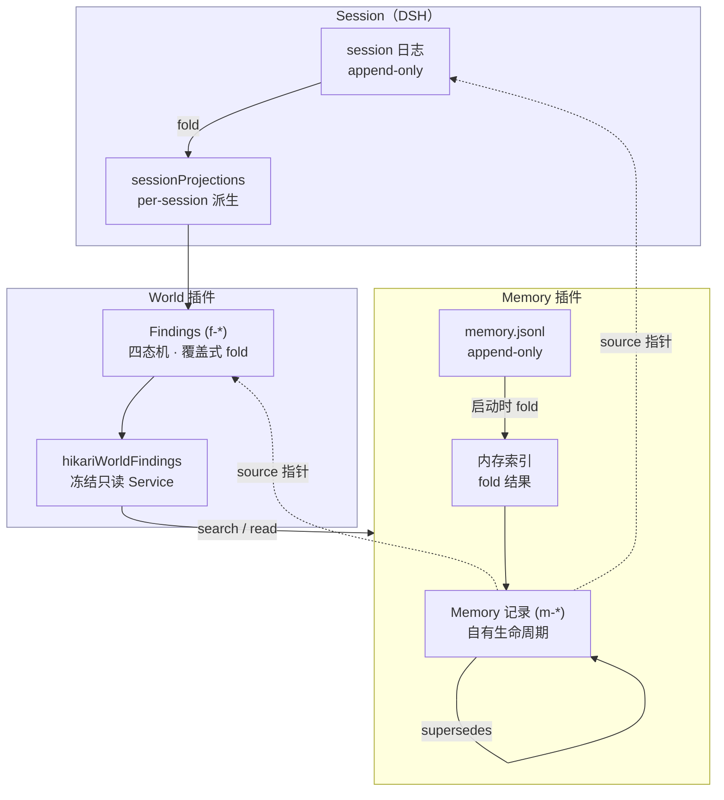

# Memory Core 架构 v0.1（M2）

状态：**设计稿，待人工审阅**。不实现、不改 `hikari-native/`、不改工具定义。

标注约定（全文一致）：

- **[F] 已验证事实**：从代码里读出来的，可直接核对，带 `文件:行号`。
- **[I] 设计推论**：由事实与约束推出的判断，理由写在同一段里。
- **[H] 待实验假设**：当前无法确认，需要后续实验或真实运行验证。

依据文档：`experiments/m2-code-facts.md`（事实表）、`experiments/m2-design-options.md`（候选比较）。

---

## 1. 当前状态与问题分析

### 1.1 现在有什么

**[F] Memory 是一个空壳**。`hikari-native/memory/index.js` 只做三件事：注入 `hikariWorldFindings` 服务、检查工具名冲突、把两个工具注册出去。它自己不持有任何数据。

**[F] 两个检索工具的数据全部来自 World**。`memory/tools.js:11` 的 `installMemoryTools(ctx, service)` 把 `execute` 换成 `service.search` / `service.read`，工具名、描述、参数、输出 schema 与 World 自己那份逐字相同（`memory/tools.js:1-8` 的注释写明「逐字搬来」）。

**[F] World 的数据也只有一种：Finding**。八个字段（`world/findings.js:149-158`），四个状态（`:69`），两种来源（`:70`）。

**[F] 唯一持久载体是 Session 日志**，通过 `sessionProjections.register` 派生成内存状态（`world/findings.js:379-385`），恢复靠重放 `apply`（`:159`）。

**[F] 注入预算 3 条 / 1200 字符**（`world/findings.js:44-45`），每请求求值一次（`:396-400`）。

### 1.2 六个问题（本文档要回答的）

| # | 问题 | 现有结构为什么答不了 |
|---|---|---|
| 1 | 存什么 | 只有 Finding 一种记录；Finding 是「现在认为什么」，不是「过去发生过什么」 |
| 2 | 怎么持久化与恢复 | 载体绑在 session 上，跨 session 即断（`currentFindings()` 依赖 `ctx.sessions.get`，`:387-393`） |
| 3 | 怎么描述时间与有效性 | 只有 `recordedAt`（`:156`），无语义上的「何时发生」与「何时失效」 |
| 4 | 怎么追溯来源 | `evidence.seq` 只在当前 session 可解析（`:99`、`:284-285`） |
| 5 | 怎么与 World / Session 协作 | 现有依赖是单向 `memory → world`，但 Memory 无自有数据，谈不上协作 |
| 6 | 怎么让模型自主读写 | 已有 `search_memory` / `read_memory`，没有写入；检索不能按时间筛（`:233`） |

**[I] 核心判断**：M1 完成的是「让 Memory 有一个可以接管的位置」，M2 要解决的是「接管之后接管什么」。这要求 Memory **拥有自己的数据**，而不是继续做 World 的转发层。

---

## 2. Memory 的职责边界

### 2.1 三者分工

| | 回答的问题 | 生命周期 | 所有者 |
|---|---|---|---|
| **Observation** | 世界发生了什么 | 一次感知，进入 session 日志 | Session（DSH） |
| **Finding** | 我现在认为什么是真的 | 可被推翻，有终态 | World |
| **Memory** | 哪些过去经历值得未来重用 | 不终止，只变旧 | Memory |

**[F] 这个三分写在 M0 架构文档里**：`docs/architecture/hikari-base-plugin-architecture-v0.1.md:38` 原文「Observation（世界发生了什么）/ Finding（Hikari 目前认为发生了什么 + 证据）/ Memory（哪些过去经历值得未来重用）是三个不同概念」，同一文件 `:36` 的四域矩阵里 Memory 一行写着「明确不负责：保存『世界现在是什么』」。**但要注意该文件 `:46` 紧接着写「这是现状，不是永久规则。」**——所以这三行是**现状描述**，不是被冻结的裁决；它的约束力来自本轮任务书里「三个概念必须严格区分」那句话，不来自该文档本身。本文档按这个三分展开，若将来其中一条被证明不成立，改的是三分而不是这份文档的其余部分。

### 2.2 Memory 必须负责的

1. 长期记忆记录的**数据与生命周期**（创建、修正、老化）。
2. **跨 session** 的可检索性。
3. 记忆到来源的**指针**（不复制来源内容）。

### 2.3 Memory 明确不负责的

| 不做 | 理由 |
|---|---|
| 判断世界现在是什么状态 | 那是 World 的职责（Finding） |
| 保存对话原文 | 那是 Session 的职责 |
| 自动把 Finding 变成 Memory | 任务书禁止；且「值得复用」是语义判断，不是同步策略 |
| 决定什么值得记 | 那是模型的判断（§7） |
| 自动让记忆过期 | 这会把 `validHint` 变成 TTL（§5.3） |
| 提供统一的「事实」查询 | 事实查询归 World；Memory 只回答「我记得什么」 |

**[I] 一句话边界**：World 回答「现在是什么」，Memory 回答「我记得什么、什么时候、从哪来」。两者互不代理。

---

## 3. 数据模型候选

比较见 `experiments/m2-design-options.md` §1。结论：**分层 + 引用**，Memory 记录自有 id 与生命周期，来源以指针形式保存。

被否决的两个候选与理由（正文直接给出，不只放在外部分析文件里）。下表引用的 `findings.js` 行号均属 **[F]** 类事实，判断与理由属 **[I]**：

| 候选 | 做法 | 排除理由 |
|---|---|---|
| A 沿用 Finding 结构 | 在 `findings.js:149-158` 的八字段上加 `observedAt` / `validTo` | **边界问题而非成本问题**：Finding 有终态（`findings.js:74-75` 的 `refuted`/`resolved` 无出边），Memory 不需要终态、只需要变旧。合并后必然要给 Memory 引入它不需要的 `refuted` 语义，或给 Finding 引入它不需要的「年龄」 |
| B 完全独立 | 新建结构，不引用 Finding | 丢失来源追溯。她写过的 f-003、f-004 这类判断沉淀成教训时，最有用的一句是「来自哪次验证」；不引用就只能把来源写成自由文本，那是复制不是引用 |

| 候选 | 做法 | 排除理由 |
|---|---|---|
| C 分层 + 引用 | 自有 id 与生命周期，`source` 存指针 | **采纳**：满足「两套数据所有权独立」，同时保留追溯；指针失效是可表达状态（§6.2），不是异常 |

### 3.1 记录结构

```js
{
  memoryId,      // 自有命名空间（与 f-* 区分）
  text,          // 模型写下的正文，不设模板
  occurredAt,    // 事件发生时间；未知为 null
  recordedAt,    // 写入时间；工程填
  validFrom,     // 可选：从何时成立；null = 未知
  validTo,       // 可选：到何时为止；null = 未知（不是"永久"）
  validHint,     // 可选：模型自报的失效预判，自然语言
  source,        // { kind, ref }，见 §6
  supersedes,    // 可选：这条替代了哪条 memoryId
  seq,           // 写入事件在当时的 session 中的位置（可选的辅助定位）
}
```

**[I] 为什么 `text` 不设模板**：一旦规定「必须写成『发生了什么 / 因为什么 / 以后怎么做』」，模型就会填表而不是思考。结构应该来自内容，不来自表单。

### 3.2 刻意不设的字段

| 不设 | 理由 |
|---|---|
| `confidence`（数值） | 数值置信度会让模型以为工程在替它算概率；且没有校准方法，写了也是假的 |
| `kind`（episode / lesson / preference 枚举） | 有枚举就会先分类再写；分类本身是模型该做的判断，不是 schema 该规定的事 |
| `tags` | 检索已用词元重叠（`findings.js:205-217`），再加标签层只会两套索引打架 |
| `importance` / `score` | 同上，且会让「排序」变成一个看似客观实则无依据的数字 |

**[H] 待验证**：去掉 `kind` 之后，检索是否还能有效区分「一段经历」与「一条教训」。如果实测发现模型写出来的记录混在一起无法召回，再考虑引入**由模型自己填**的自由文本 `note` 字段，而不是枚举。

### 3.3 与 Finding 的结构对照

| | Finding | Memory |
|---|---|---|
| id | `f-001`（`findings.js:68`） | `m-001`（**[I]** 同构命名） |
| 状态 | 四态机，有终态（`findings.js:71-76`） | 无状态机；「新鲜度」由时间表达 |
| 修正 | 覆盖式 fold（`findings.js:159`） | `supersedes` 链，不覆盖（§6.3） |
| 时间 | `recordedAt` 一个 | `occurredAt` + `recordedAt` + 可选区间 |
| 作用域 | `scope.project` + `scope.sessionId` | 项目 + 跨 session |

---

## 4. 持久化方案比较

比较见 `experiments/m2-design-options.md` §2。结论：**独立 append-only 文件**。

### 4.1 为什么不是 Session 投影

**[F] 投影的作用域是 session**：`currentFindings()` 内部是 `ctx.sessions.get(sessionId)` → `ctx.sessionProjections.stateOf(session, key)`（`findings.js:387-393`）。

**[I] 长期记忆的定义就是「跨 session 还在」**，与投影的 per-session 作用域直接冲突。要跨 session 只能重放全部历史日志，成本随对话量线性增长，且归档后断链。

**候选 C（复用 DSH 已有的会话/档案存储）也被排除**，理由与 A 同源但更硬：DSH 的会话存储只能按 `sessionId` 定位（`ctx.sessions.get(sessionId)`）或按 projection key 折叠（`ctx.sessionProjections.stateOf`，`findings.js:387-393`），没有「跨全部 session 按内容检索」的入口；profile 目录（`.dsh/profiles/<name>/`）存的是配置（`package.json` 与 `cordis.patch.yml`），不是可变数据集，往里写会污染 profile 语义。`experiments/m2-design-options.md:73-79` 当时把它标为「排除理由（暂定）」——此处补实：**C 不是「另一条存储路」，而是「借别人的目录放自己的数据」**，所有权与崩溃恢复语义都不清，故排除。

### 4.2 推荐形态

```
<hikari 数据目录>/memory/
  memory.jsonl        ← append-only，一行一条记录
  memory.meta.json    ← { schemaVersion, createdAt, recordCount }
```

**[I] 与现有 projection 同构**：`apply(record)` 折叠成内存 Map，与 `applyFindingRecord`（`findings.js:139-160`）形状一致。区别只有一处：来源从 session 事件变成文件行。

**[I] 为什么不是数据库**：任务书禁止；且当前规模（预计数百到数千条）用 JSONL 足够，检索在内存里做（现有 `searchFindings` 就是全表扫描，`:239`）。

### 4.3 必须处理的四件事

| 事项 | 做法 | 依据 |
|---|---|---|
| 追加原子性 | 单次 `appendFile` 写完整一行，以 `\n` 结尾，解析时容忍坏行 | **[H]** 平台假设：单行 ≤ 数 KB 时单次 write 不撕裂。未在 NTFS 与 POSIX 上实测 |
| 部分写入恢复 | 解析失败的行**丢弃并记一条警告**，不阻断启动 | **[I]** 与 fold 的「坏事件跳过」同构（`findings.js:142-146` 已有此模式） |
| schema 版本 | 顶层 `schemaVersion`；不匹配时**不迁移**，报告并停用 | **[H]** 迁移策略待定，M2 阶段先做「拒绝启动并明确报错」 |
| 并发写 | 单进程内用 `recordQueue` 串行（复用 `findings.js:137-141` 的模式） | **[F]** 该模式已验证可用于 findingId 分配 |

**[H] 未验证**：多实例同时写同一文件会怎样。当前每个 Hikari 实例有独立数据目录（**[I]** 假设），若实测多实例共写，需要加文件锁或改为「每实例一个文件」。

---

## 5. 时间与有效性模型

### 5.1 三个时间，各有各的用途

**[F] 为什么必须三个时间、为什么借不到现成字段**——现有 Finding 只有一个时间：`world/findings.js:149-158` 的八个字段里只有 `recordedAt`（写入时刻，`:156`），没有任何「事件发生时间」或「有效期」字段；`:69` 的 `STATUSES` 与 `:71-76` 的 `TRANSITIONS` 里 `refuted`/`resolved` 都是终态（`refuted: []`、`resolved: []`），**没有「变旧但未失效」这个状态**。所以 Memory 要表达「三天前发生、今天才记」「当时预计一周后该重查」，现有结构里一个字段都借不到，只能新增而不能复用。

| 字段 | 谁填 | 回答什么 | 缺失时 |
|---|---|---|---|
| `occurredAt` | 模型 | 这件事什么时候发生的 | `null` = 不知道，不是「就是现在」 |
| `recordedAt` | 工程 | 这条记忆什么时候写下的 | 不会缺失 |
| `validHint` | 模型（自然语言） | 我觉得它大概多久会过时 | `null` = 没有预判 |

**[I] 三者不可合并**。`occurredAt` 缺失时若回退成 `recordedAt`，会把「三天前发生、今天才记」的经历标记成今天的——这是事实表第一条缺口的直接后果。

### 5.2 工程提供什么、模型判断什么

| 工程负责 | 模型负责 |
|---|---|
| 提供当前时间 | 把「昨天」「上周三」换算成绝对时间 |
| 计算并渲染 age（距 `occurredAt` 多久） | 判断这个 age 意味着「还新鲜」还是「该重新查了」 |
| 表达 `validTo` 是否已过去（**只表达，不动作**） | 决定是否因为这个信息去重新验证或改写这条记忆 |
| 保证 `recordedAt` 可信 | 判断「这条是我当时想清楚了的，还是随手记的」 |

**[I] 这条分工是本文档最重要的一条**：工程任何自动动作（过期、降级、隐藏、重排）都会把语义判断从模型手里拿走。工程只做两件事——**给信息**、**存状态**。

### 5.3 为什么这不叫 TTL

| | TTL | `validHint` + `validTo` |
|---|---|---|
| 谁决定失效 | 工程按固定时长 | 模型按内容与语境 |
| 到期发生什么 | 自动删除 / 自动降级 / 自动隐藏 | **什么都不发生**，只是读的时候多给一句话 |
| 能否表达「不确定」 | 不能 | `null` 就是不确定 |
| 能否被推翻 | 到点就执行 | 模型读到「大概一周」时若发现已经两周，可以自行决定重查 |

**[I] 判别标准**：如果实现里出现「`validTo` 已过 → 自动把状态改成 x」，那就已经变成 TTL 了，无论字段叫什么。

### 5.4 渲染给模型的样子

```
m-012  3 天前发生 · 12 天前记录 · 当时预计：除非 CI 配置改了，否则一直成立
m-007  2 个月前发生 · 2 个月前记录 · 当时预计：一周内有效
```

**[I] 渲染不排序、不标注「已过期」**。排序会暗示优先级，标注「已过期」等于替模型下了结论。

---

## 6. 来源追溯机制

### 6.1 记什么

`source` 是一个指针，不是副本：

```js
{ kind: 'finding',      ref: 'f-004' }
{ kind: 'session',      ref: '<sessionId>#<seq>' }
{ kind: 'file',         ref: 'hikari-native/world/findings.js:149' }
{ kind: 'conversation', ref: <sessionId> }
{ kind: 'inference',    ref: null }         // 由已有记忆推出，无直接证据
```

**[F] Finding 指针可行**：finding 有稳定的 `findingId`（`findings.js:68` 的正则约束了格式），且 World 已暴露 `read(id)`（`:287`）。

**[F] Session 指针不可直接解析**：`evidence.seq` 跨 session 无法定位（`:99`、`:284-285`）。所以 session 类来源**只能记录**，不能保证可回查。

### 6.2 读的时候怎么表达

| 指针状态 | 渲染 |
|---|---|
| 可解析 | 「来源：f-004（World 中的判断）」，并可选择读它 |
| 指针格式对但目标不存在 | 「来源：f-004（已不可达）」 |
| 只有 session 引用 | 「来源：某次对话（无法回查原文）」 |
| `inference` | 「来源：由已有记忆推出，没有直接证据」 |

**[I] 「不可达」是合法状态，不是错误**。把它做成异常会迫使实现方去复制原始内容（防止失效），而复制正是任务书禁止的「偷偷维护另一份事实」。

### 6.3 修正链

`supersedes` 单向指向：新记录指向被它替代的旧记录。

**[I] 为什么不在旧记录上写 `supersededBy`**：append-only 流里改旧行会破坏追加语义。反向查询用索引（内存 Map）实现即可。

**[F] 这与 Finding 的做法不同**：Finding 是覆盖式 fold（`findings.js:159`），旧状态只剩在 session 日志里、接口层读不到。Memory 明确不重复这个问题——**历史在 Memory 里是一等公民**。

---

## 7. 模型自主读写机制

### 7.1 最小接口集

| 工具 | 作用 | 状态 |
|---|---|---|
| `search_memory` | 找候选，不返回正文 | **[F] 已存在**（M1 接管） |
| `read_memory` | 读一条完整正文 | **[F] 已存在** |
| `write_memory` | 写一条新记忆 | **[I] 需新增** |
| `revise_memory` | 修正一条（追加新记录 + `supersedes`） | **[I] 需新增** |

**[I] 只加两个写入工具，不合并成一个**。「记一条新的」与「修正旧的一条」在模型侧是两种不同的判断，合并后必然要加一个 `mode` 参数，而参数化正是把判断推回给工程。

### 7.2 写入不设规则

**[I] 不实现任何自动写入**：
- 不在 turn 结束时自动抽取
- 不在 Finding 变化时自动同步（任务书禁止）
- 不在 systemPrompt 里写「你应该记住什么」的规则

模型看到的是：工具存在、描述清楚、用不用随它。这与现有 `search_memory` 的描述风格一致（`memory/tools.js:14-18`：末尾那句「Searching is your choice, not a required step」）。

### 7.3 回忆不设触发

**[I] 检索永远由模型发起**。不实现「相关记忆自动注入」——那会变成第二次 `systemPrompt.context`，而注入什么就是替模型做了「读哪条」的判断。

**[I] 但保留一件事**：当前有效 Finding 的注入（`findings.js:396-400`）继续存在，那是 World 的职责、不是 Memory 的。Memory 不往 systemPrompt 里塞东西。

### 7.4 模型需要知道什么才能判断

写入时要让它知道「现在几点」——否则它无法把「昨天」换算成绝对时间。

**[H] 待验证**：DSH 是否已在 runtime context 里给出当前时间。若没有，需要在 `write_memory` 的参数里带上「相对时间」或由插件注入当前时间。这属于工程**提供信息**，不属于替它判断。

---

## 8. World / Session / Memory 关系图



依赖方向（**[F] 现状 + [I] 目标**）：

- `memory → world`：单向，**已存在**（`hikari-native/memory/index.js:15` 的 `inject = ['tools', 'hikariWorldFindings']`）且 World 不认识 Memory（`hikari-native/world/findings.js` 全文无 `hikari-memory` 字样）。
- `memory → session`：只读日志（**[I]** 通过 DSH 已有的 session 接口），Session 不认识 Memory。
- **World 不依赖 Memory**，Memory 不依赖 World 的内部结构（只依赖冻结的 Service 契约）。

**[F] 工具名的「唯一提供者」有两道约束，行为不同**：①`tools.register()` 把定义 `insert` 进 `layers.effect` 选中的 layer（`G:\work\LAB\code\_poc\poc01\node_modules\@deepseek-ai\dsh-tools\lib\index.js:2982` 的 `return this.layers.effect(this.ctx, (layer) => layer.tools.insert(name, definition), { label: "tools.register()" })`）；`ScopedLayers.effect` 在 `scopeOf(ctx)` 为 `undefined` 时用**同一个 `this.global` layer**（`…/dsh-scope/lib/index.js:195` 的 `if (scope === void 0) layer = this.global;`），而 layer 的 `NamedEntries` 在重名 `insert` 时抛 `tool "<name>" is already registered`（`…/dsh-tools/lib/index.js:2731` 的 `new NamedEntries((name) => new Error(…))` 错误工厂）——**所以同一 layer 内重名是加载失败，不是静默覆盖**；`register()` 的文档注释 `:2969-2970` 也写着 "Scoped tools shadow globals; duplicates within one layer and the reserved `run_code` name fail."。②跨 scope（`agent.ctx`）的同名注册是 `shadow` 关系，不报错（同一条注释的前半句）。因此 M1 在 `memory/index.js` 的 `apply` 开头保留自己的启动期检查，防的是第 ② 种（静默 shadow）与「World 忘了关 `registerMemoryTools` 时两侧同时存在」——**两道约束是互补的，不是重复**。

---

## 9. 生命周期与恢复机制

### 9.1 启动

```
1. 读 memory.meta.json → schemaVersion 校验
2. 不匹配 → 停用 Memory 插件，输出明确错误（不迁移、不猜测）
3. 匹配 → 逐行读 memory.jsonl，坏行跳过并计数
4. fold 成 Map<memoryId, record>
5. 构建 supersedes 反向索引
6. 输出 ready 行（console.error，沿用 M1 的可见性结论）
```

**[F] ready 日志必须走 `console.error`**：`ctx.logger.info` 既不落盘也不进 GUI。依据是 `G:\work\LAB\code\_poc\poc01\node_modules\@deepseek-ai\dsh-app-boot\lib\index.js:4513` 的 `levels: { default: 2 }`——该 exporter 只放行 warn/error，且只把记录推进 `startupLogs`（仅在启动失败时展示），info 级进 logger buffer 等于看不见。`hikari-native/memory/index.js:44-46` 的注释是对这一源码发现的记录，不是独立证据；`:49` 是 `console.error(...)` 的实现。

### 9.2 运行

- 写入：追加一行 → 更新内存索引 → 返回。
- **[I] 写完不回读文件**。回读会把「文件是不是真的写对了」和「逻辑对不对」混在一起。
- **[H] 是否需要 fsync**：M2 阶段先不做，接受「进程崩溃丢最后一行」；若实测发现丢行影响使用再补。

### 9.3 卸载与重启

- **[F] 工具注册自动跟随 fiber 生命周期**：`tools.register()` 的最后一行是 `return this.layers.effect(this.ctx, (layer) => layer.tools.insert(name, definition), { label: "tools.register()" })`（`G:\work\LAB\code\_poc\poc01\node_modules\@deepseek-ai\dsh-tools\lib\index.js:2982`），而 `ScopedLayers.effect(ctx, action)` 的实现是 `return ctx.effect(function* () { … yield* action(layer) })`（同目录下 `@deepseek-ai/dsh-scope/lib/index.js:189-192`）——两条都在 PoC 安装目录而不在本仓库，故给全路径。卸载语义在两处实测过：`experiments/m1-world-service/probe-lifecycle.mjs` 用一个两行插件证明 `fiber.dispose()` 会触发 effect disposer、service 变 `undefined`、重装后重建（该文件 `:16-18` 注册 effect、`:33` 调 `dispose()`、`:35` 读 service、`:41` 重装）；真实 Memory 插件则由 `hikari-native/test/memory.test.mjs:157`（卸载后两个检索工具消失、`record_finding` 仍在）与 `:167`（重新加载后工具恢复）覆盖。**所以不需要手写注销函数**。探针用的是通用插件而非 `hikari-memory` 本身，二者区别在此说明。
- 文件不删、不重写。重启即重放。

### 9.4 损坏恢复

| 情况 | 处理 |
|---|---|
| 单行 JSON 解析失败 | 跳过该行，计数，ready 行里报告 `skipped: N` |
| 整个文件不存在 | 视为空记忆，正常启动 |
| `memoryId` 重复 | 后者覆盖前者，并计数报告（**[I]** 与 fold 的覆盖语义一致） |
| `schemaVersion` 不匹配 | 停用插件，明确报错 |

---

## 10. 风险、替代方案与未决问题

### 10.1 风险

| 风险 | 后果 | 缓解 |
|---|---|---|
| 记忆膨胀 | 检索召回变差，模型读不完 | **[I]** 不设上限，但 `search_memory` 有 800 字符硬预算（`findings.js:51`），超出从尾部减条数（`:274-277`） |
| 模型写垃圾 | 一堆无信息量的记录 | **[I]** 这是模型自由度的代价；可观察（记录数增长），但不加过滤规则 |
| 指针大面积失效 | 来源追溯形同虚设 | **[I]** 明确「不可达」是合法状态；不因此复制内容 |
| `supersedes` 链过长 | 读一条要追十条 | **[I]** M2 不做传递闭包，读一条就是一条 |
| 多实例共写文件 | 行交错 | **[H]** 未验证，见 §4.3 |
| schema 演进 | 旧文件读不了 | **[I]** M2 选择「拒绝启动并报错」，把迁移留给 M3 决定 |

### 10.2 明确被排除的方案

| 方案 | 排除理由 |
|---|---|
| 向量数据库 | 任务书禁止；且当前规模不需要 |
| Finding → Memory 自动同步 | 任务书禁止；「值得复用」是语义判断 |
| 固定 TTL | 任务书禁止；且会把语义判断从模型手里拿走 |
| GlobalWorldState | `docs/architecture/core-architecture-v0.md:401`（§11「明确禁止重新引入的结构」，标题在 `:394`） |
| Memory 成为统一记忆所有者 | 用户明确：Memory 可以是统一访问入口，不能是统一所有者 |
| 在 Memory 里复制 Finding 内容 | 违反「每份状态只有一个所有者」 |

### 10.3 未决问题（交人工决定，见末节）

1. Memory 是否从一开始就独立成安装包（M0 已说「不影响本次边界」，此处只记录）。
2. 数据目录位置与命名（是否跟随 `DSH_HOME`）。
3. 是否现在就加 `write_memory` / `revise_memory`，还是 M2 只做存储层。
4. `schemaVersion` 演进策略。
5. 多实例是否可能共写同一文件。

---

## 11. 推荐实施阶段与验收标准

**[I] 分三步，每步都可独立验收、都可回滚。**

### M2-a：存储层（无工具改动）

- 实现 `memory/store.js`：`append` / `fold` / `readAll`，含损坏跳过与 schema 校验。
- 不改任何工具定义、不改 `cordis.patch.yml` 的插件列表（先不挂载）。
- **验收**：单测覆盖「空文件 / 坏行 / 重复 id / schema 不匹配」四种；用一份手写 jsonl 折叠出正确 Map；进程重启后状态一致。

### M2-b：写入工具

- 新增 `write_memory`：参数 `text / occurredAt / source / validHint`，`recordedAt` 由工程填。
- 新增 `revise_memory`：参数 `memoryId / text / …`，写入新记录并填 `supersedes`。
- **验收**：写一条 → 重启 → `search_memory` 找得到 → `read_memory` 读得到原文；`revise_memory` 之后两条记录都在文件里、新记录带 `supersedes`；工具名与 World 不冲突（沿用 M1 的启动期检查）。

### M2-c：来源解析与时间渲染

- `read_memory` 返回里带 `source` 的可达性判断（可解析 / 不可达 / 无直接证据）。
- 检索结果带 `occurredAt` / `recordedAt` / age；加 `since` / `until` 过滤。
- **验收**：构造一条指向不存在 finding 的记录，读出来显示「已不可达」而不是报错；age 按 `occurredAt` 而不是 `recordedAt` 算。

### 不做的事（本轮）

- 不实现自动写入、不实现自动注入、不实现记忆合并/去重、不实现跨项目检索、不实现迁移工具。

---

## 需要人工决定的事项

| # | 事项 | 推荐 | 替代方案 |
|---|---|---|---|
| 1 | 是否现在引入 `write_memory` / `revise_memory` | **是**，M2-b 就做——没有写入就没有记忆 | 先只做存储层，写入留到 M3 |
| 2 | 数据目录位置 | 跟随 `DSH_HOME` 下的 `hikari/memory/` | 仓库外独立目录（与实例解耦更强） |
| 3 | `schemaVersion` 不匹配时 | **拒绝启动并报错** | 尝试兼容读（风险更高） |
| 4 | 是否允许记忆里保存对话原文片段 | **允许模型自己决定，但工程不自动截取** | 完全禁止（会丢掉关键语境） |
| 5 | `source` 指向 session 但无法回查时 | 只记录、渲染成「无法回查」 | 拒绝写入这类来源（太严，会挡住大量真实记忆） |
| 6 | 是否需要在 systemPrompt 里注入「记忆条数」之类的概览 | **不注入**（注入即暗示优先级） | 只注入一句「你有 N 条记忆」（仍有暗示） |
| 7 | M2 是否需要处理多实例共写 | **先假设不需要**，实测后再定 | 一开始就加文件锁 |
| 8 | 记忆无限增长是否可接受（本文档只做到「不自动过期」，没有清理机制） | **M2 接受无限增长**——清理是语义判断，不能由工程按条数或时长做 | 引入模型主动删除工具（`forget_memory`），由模型自己判断哪条该忘 |
