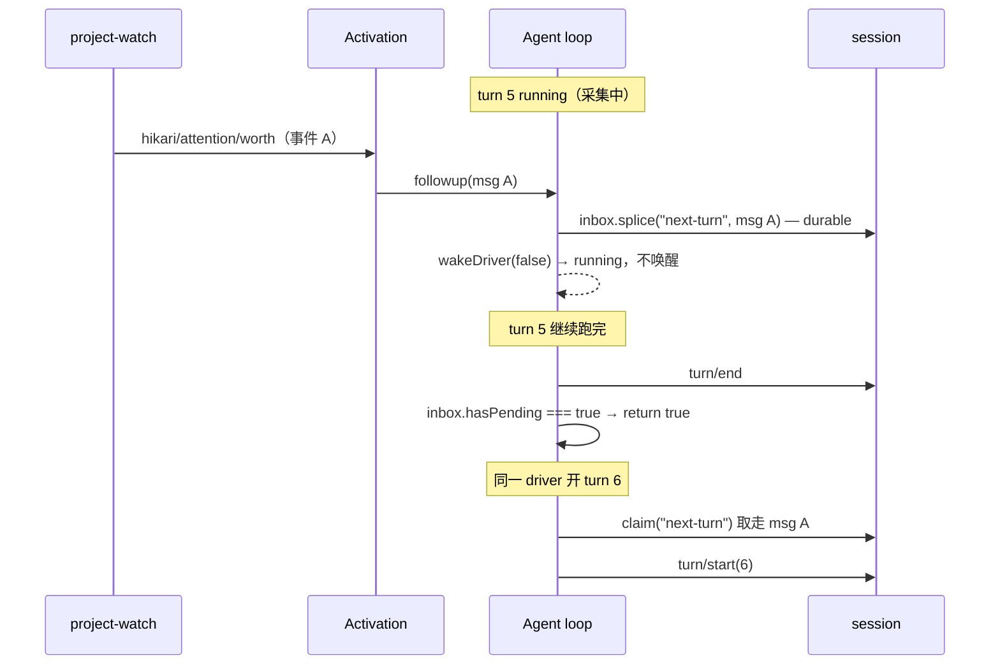

# Hikari Native v0 — Event Delivery：turn 运行中的事件投递语义

> 调查对象：`@deepseek-ai/dsh-agent-loop@0.2.1-rc.2`（`lib/index.js`，2023 行）
> 触发问题：`f-004`——她收到的唤醒文字描述的变化，与 trace 记录的触发事件不是同一次采样。
> 结论先行：这不是缺陷，是 `followup` 的排队语义。

---

## 一、三个问题的答案

| 问题 | 结论 | 位置 |
| --- | --- | --- |
| 运行中 turn 收到新事件会怎样 | **排队**，不丢、不并发。当前 turn 跑完后由同一 driver 立即开下一个 turn 消费 | `dsh-agent-loop/lib/index.js:800-805`、`:1037-1041` |
| 多个事件能否合并 | **不能**。每个 turn 只取 1 条 `next-turn` 消息，N 条事件 = N 个 turn 依次执行 | `:103-106` |
| 不能立即处理是否保留 | **保留**（durable）。inbox 是 session projection，进程重启后从 session 重建；但 `cancel()` 会清空它 | `:780`、`:20-51`、`:815-821` |

---

## 二、运行中到底发生了什么

Activation 投递走的是 `followup`（`hikari-native/activation/index.js:87`），展开是：

```text
followup(input)  →  send(input, "next-turn", true)      // :806-808
send(...)        →  inbox.splice("next-turn", ...)      // :803  消息进队列
                 →  wakeDriver(false)                   // :804
```

关键在于 `wakeDriver` 的第一段（`:854-858`）：

```js
wakeDriver(wakeAfterAbort = false) {
  if (this.phase.kind !== "idle") {
    if (abortedCancelCause(this.phase.abort.signal)?.kind !== "disposed"
        && (this.phase.kind === "maintenance" || wakeAfterAbort)) {
      this.phase.wakeRequested = true;
    }
    return;                       // ← 正在 running 且未 abort：什么都不做
  }
  ...
}
```

`followup` 传的是 `wakeAfterAbort = false`，且此时 phase 是 `running`（不是 `maintenance`），所以**两个条件都不成立，直接返回**——不启动第二个 driver，也不置 `wakeRequested`。

**那消息去哪了？** 已经在 `inbox` 里。`kick()` 的循环是 `while (await this.turn())`（`:887-889`），而 `turn()` 在写完 `turn/end` 之后有这一段（`:1037-1041`）：

```js
if (!this.inbox.hasPending) return false;
phase.abort = new AbortController();
phase.wakeRequested = false;
phase.step = 0;
return true;
```

`hasPending` 只要 `next-turn` 或 `next-step` 有一个非空就为真（`:88-90`）。所以当前 turn 正常结束 → 发现队列里还有东西 → 返回 `true` → **同一个 driver 立刻开下一个 turn**。

时序长这样：



**所以她不是在「跑到一半被打断」，也不是「事件丢了」——她是把话听完，然后再单独起一轮来处理刚发生的事。**

`f-004` 的「唤醒文字 9→10、trace 11→10」正是这个结构的正常表现：那条 9→10 的事件是**之前**排进队列的，而 trace 是在 `e3b7393` 才加进去的，只记录它之后发生的 emit。两者本就不是同一次。

---

## 三、多事件不合并，但实际积压有上限

`claim(target, turn)`（`:103-106`）：

```js
const claimed = this.mutate("next-step", 0, this.nextStep.length, [], false);
if (target === "next-turn") claimed.push(...this.mutate("next-turn", 0, 1, [], false));
```

- `next-step` 全取（这些是工具执行期间注入的上下文）
- `next-turn` **只取 1 条**

所以两条 followup 不会被拼成一轮，而是排成两轮。这既是保护（每件事单独处理，不会因为合并而漏看），也是成本（事件越密，轮数越多）。

实际不会失控，因为 `project-watch` 自己有两道约束：`emitting` 锁（同一条事件发出期间不重复发，`hikari-native/project-watch/index.js:126-133`）与 120 秒冷却（`:24-25`）。最坏情况是积压 1 条。

---

## 四、保留，但不是队列

`ReactLoopInbox` 建在 `sessionProjections` 上（`:780`），每次 splice 都写到 session 里（`:20-51` 的 schema 与 fold）。这意味着**进程重启后 pending 消息还在**——它比内存队列耐久。

但别把它当队列用：

- `cancel()` 默认 `inbox.clear()`（`:815-821`）。中断一次，未处理的全部消失。
- 没有优先级、没有过期、没有去重。一个事件就是一条消息，原样保留到被 claim。

**如果希望「被打断后还记得刚才发生过什么」，得自己留痕。** 这次不实现，但记在这里：未来的 `world` 可以考虑把最近若干条 `worth` 事件写成持久投影，这样 `cancel` 丢掉的只是「要不要现在处理」，不是「发生过什么」。

---

## 五、这对当前实现意味着什么

1. **Activation 不需要自己的排队逻辑。** `followup` 已经提供「不丢、不并发、turn 边界消费」。多加一层队列只会和它打架。
2. **冷却期内的丢弃是 project-watch 的选择，不是 DSH 的限制。** DSH 允许你每条都发、全部排队；我们在 `project-watch` 里主动丢，是为了避免「她在忙的时候，事件把她的轮次塞满」。这个取舍写在 `hikari-native-driver-source-v0.md` 第四节。
3. **`f-004` 不是 bug。** 它是「排队语义 + trace 晚建」的合成结果。如果以后要避免这类误判，正确做法是让 trace 与事件**同时开始记录**，而不是让 Activation 去改投递方式。

---

## 六、未验证的部分

以上结论全部来自 `@deepseek-ai/dsh-agent-loop@0.2.1-rc.2` 的源码阅读，**没有做运行时实验**。

没有做的事：故意在她运行时连发两条事件，观察是否真的开出两个 turn。理由是源码路径足够直（`send` → `inbox` → `hasPending` → `return true`），且这条链在 `turn()` 里是线性代码、没有分支能绕开 `:1037`。但这仍是推导，不是读数——如果以后行为与本文不符，以运行时为准。

DSH 是只读依赖，这份文档只是阅读记录，不构成对上游的修改建议。
