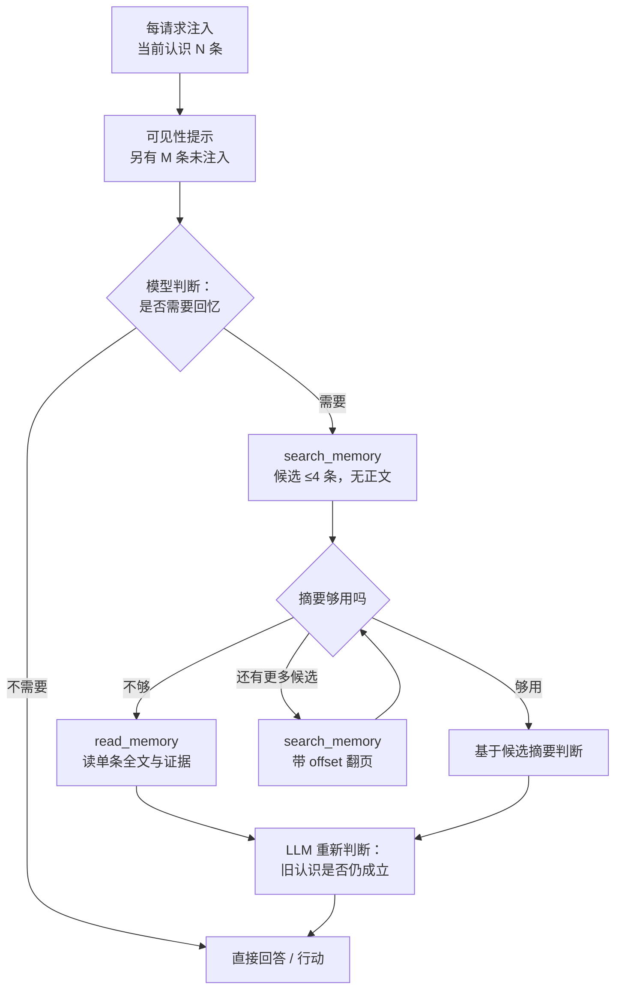

# 模型自主检索记忆：最小能力定义

**状态：冻结稿 v2（决策已定，附架构审阅记录）**

- v0 范围 = Findings 检索闭环。Session Episode 与灵枢不在本稿范围内（§7.1）。
- 依据：`hikari-native/world/findings.js`（382 行）与灵枢 `read` 的实测返回。
- 决策记录见 §10；架构审阅见 §9。

---

## 0. 这份文件只回答一个问题

> 要让 Hikari 自己决定「什么时候回忆、回忆什么」，模型手里必须有什么？

不是「记忆怎么存」——那部分已经存在（Session 日志 + Findings projection）。这里只定义**模型可见的接口**。

**一条原则，写进设计**：

> Hikari 不需要在每次唤醒时知道自己过去的全部认识。她需要知道自己拥有可以回顾的历史，并且有能力在需要时自主寻找、读取和重新判断。

目标不是「把更多记忆塞进上下文」，而是「让模型拥有使用记忆的能力」。

---

## 1. 三个层次

| 层次 | 回答的问题 | 谁触发 |
|---|---|---|
| **Visibility** | 我还有多少认识没有被展示？ | 每请求自动注入 |
| **Search** | 哪些过去的认识可能与当前问题有关？ | 模型决定 |
| **Read** | 我想深入了解哪一条的具体内容？ | 模型决定 |



**边界**：Visibility **只**告诉模型「当前上下文不包含全部历史认识」，**不**暗示哪些记忆值得读。哪些相关、要不要读、读几条，全部留给模型。

---

## 2. 现状：两处空白，一处过重

| 来源 | 有什么 | 缺什么 |
|---|---|---|
| `world/findings.js` | `record_finding` 写入；每请求注入最近 3 条（1200 字符预算，`findings.js:124-152`） | **没有任何读取工具**；注入只报「已闭合 N 条」，不报还有多少有效但被截断 |
| Session 日志 | 完整经历（观察、推理、工具调用与结果） | 无按需回查接口；跨进程要自己解 `.jsonl.zstd` |
| 灵枢 `lingshu_cg(op="read")` | 语义 + 词法检索、时间窗、来源会话、质量标记 | **搜与读合并**：实测一次 5 条 = 27 KB（单条是一份裁决全文）。对 45 秒唤醒的循环不可用 |

结论：findings 是「只写不读」，灵枢是「读的粒度等于全部」，Session 是「不可主动回查」。

---

## 3. 能力定义

### 3.1 Visibility —— 独立计额的一行提示

`renderFindings` 现在只输出「已闭合 N 条」（`findings.js:141-145`）。补一块：

```
记忆可见性
当前展示 3 条有效 Finding，另有 7 条有效 Finding 未注入，可使用 search_memory 按需检索。
```

**规则**

1. Finding 内容继续使用原来的 **1200 字符预算**。
2. **可见性提示独立计额**，不占用该预算。理由：前者控制「当前认识的内容注入量」，后者告诉模型「还有多少没展示」，两者职责不同，不应互相挤占。
3. 只有 `M > 0` 时展示。
4. `M = （open + confirmed 总数）− 实际展示条数`，与 `findings.js:126-139` 的过滤条件一致。
5. 措辞不得写「更早的」——未注入的原因可能是条数上限，也可能是字符预算，与时间先后无关。

### 3.2 `search_memory` —— 找候选，不返回正文

**输入**

| 字段 | 类型 | 说明 |
|---|---|---|
| `query` | string | 模型自己的话；不要求关键词切分 |
| `limit` | integer 可选 | 默认 **4**，上限 20。**是上限，不保证返回这么多** |
| `offset` | integer 可选 | 默认 0，用于在同一查询下继续浏览 |

**输出**

```
{
  results: [
    { id, line, at, status, chars }
  ],
  total,        // 命中总数
  shown,        // 实际返回条数（必须真实）
  hasMore,      // 还有没有下一页
  nextOffset    // 下一页的 offset；hasMore=false 时**不出现该字段**（不是 null）
}
```

- `line`：**≤ 120 字符**，取自 claim 的截断，**不是正文**。
- `at`：`YYYY-MM-DD`。
- `status`：原样给出（`open` / `confirmed` / `resolved` / `refuted`），Read 再解释。
- `chars`：正文的**字符数**（Unicode 字符，不是字节、不是 token）。让模型在决定读之前知道代价。

**预算（硬约束）**

- **整条返回 ≤ 800 字符**，包含所有字段与结构开销。
- 默认 4 条 × 120 字符 + 固定开销 ≈ 700 字符，留余量。
- 超预算时**减少返回条数，不牺牲来源信息**；`shown` 如实反映。

**分页**

- 分页只提供能力，**不自动触发下一页**。模型自行决定是否继续翻。
- 分页**不保证快照一致**：两次调用之间若新增了 Finding，同一 offset 看到的条目可能位移。v0 规模可接受，不作快照保证。

### 3.3 `read_memory` —— 按 id 取一条

**输入**

| 字段 | 类型 | 说明 |
|---|---|---|
| `id` | string | 来自 `search_memory` |
| `offset` | integer 可选 | 字符偏移，默认 0 |
| `limit` | integer 可选 | 字符数，默认 2000，上限 6000 |

**输出——必须保留原始证据身份**

```
{
  id, findingId,
  recordedAt,
  status,                // open | confirmed | resolved | refuted
  statusReading,         // 人类可读口径，见下
  provenance,            // model-claim | tool-evidenced
  claim,
  evidence: [
    { kind: 'tool-result', seq, callId }
    | { kind: 'file', seq, path }
  ],
  scope: { project },
  text, offset, limit, totalChars, truncated
}
```

**语义要求（不可省略）**

- `status` 必须与 `statusReading` 一起给，不能只给机器值。口径沿用 `findings.js:135`：
  - `open` → 「此前的假设，尚未验证」
  - `confirmed` → 「有工具证据支持，尚未独立验证」
  - `resolved` → 「基于后续证据作出的关闭判断，不保证问题永远不存在」
  - `refuted` → 「在此前的检验范围内被否定」
- **不得把 `confirmed` 读成「现在仍然正确」**。`tool-evidenced ≠ verified`；读取时必须让模型能看到证据指针并自行重新判断。
- `evidence.seq` 是**写入时的指针**，指向当时的 Session 事件。跨重启后不保证仍可解析——读取方不得把它当作「现在还能查到的证据」的承诺。

**硬约束**

- 一次只返回**一条**。批量读会把「读哪条」的选择权收回检索层。多个独立 Read 可以并行，但那仍是模型自己的多次决定。

---

## 4. 权限与归属

| 事项 | 谁决定 |
|---|---|
| `query` 写什么、搜不搜、读哪条、读几条、翻不翻页 | **模型** |
| 检索范围（哪个项目） | **工程层**：启动时解析的授权根，与 `scoped-fs` 同一个 root |
| 跨项目是否允许 | **工程层**，v0 默认关闭 |
| 结果里带什么证据 | **工程层** |

模型**不能**传项目路径或会话 ID。

---

## 5. 与 Findings / Session / 灵枢 的边界

- Findings：当前项目的认识，有状态机与证据指针，写入靠 `record_finding`（已有）。
- Session：经历，只追加、不改写。
- 灵枢：长期跨项目记忆，有自己的置信度与生命周期。

**不一一映射，不自动同步**。将来三者可以接入同一个 Search / Read 接口，但**不统一存储，也不统一生命周期**。

---

## 6. 明确不做

1. 不按窗口标题 / 进程名自动注入相关 finding（窗口标题不等于认知需求）。
2. 不做「检索后自动排序取前 N 塞 prompt」。
3. `search_memory` **不返回正文**。
4. 不引入 embedding 索引或新存储；v0 用现有 Findings projection。
5. 不给模型传项目路径 / 会话 ID 的入口。
6. **不开放批量 Read**：工具调用效率不凌驾于模型的选择权。
7. **不规定调用顺序**：不要求每次唤醒必须 Search、Search 后必须 Read、Read 后必须更新 Finding、一次任务检索多少条。

---

## 7. v0 实施顺序与验证

### 7.1 四阶段

| 阶段 | 内容 | 范围 |
|---|---|---|
| 1 | 可见性提示 | 只改 `renderFindings` |
| 2 | `search_memory` | 只搜 Findings |
| 3 | `read_memory` | 读单条 Finding（含证据） |
| 4 | 行为验证 | 观察模型是否自主调用、如何选择 |

Search 与 Read 必须一起交付：只有 Search 时，模型知道「可能有一条相关记录」却拿不到内容，等于半成品。

**本稿不纳入 Session Episode 与灵枢**：Session 的跨进程读取接口未确认；灵枢的检索粒度与返回结构还需要研究；Findings 已有成熟的数据结构与持久化。先跑通最容易验证的部分。

### 7.2 三个验证场景

| 场景 | 预期行为 |
|---|---|
| 当前 3 条已足够 | **不**调用 Search |
| 当前任务涉及较早的 Finding | 自主调用 Search，选择相关候选 |
| Search 找到候选但信息不足 | 自主调用 Read 进一步了解 |

第三种**不是强制行为**：模型可以搜完认为摘要够用，也可以继续读。只记录实际发生什么。

### 7.3 判据口径

- 只看「有没有自主选择权」：三个场景里模型的选择是否与其掌握的信息相符。
- 不看工具调用次数、输出长度、是否「看起来在思考」。
- 若模型在场景 1 也调用 Search，或场景 2 完全不搜，都如实记录，不解释成能力成立或失败。

---

## 8. 冻结范围

**冻结**：三层结构、两个工具的输入输出形状与预算（4 条 / 120 字符 / 800 总预算 / 分页字段）、`read_memory` 的证据字段与状态措辞、可见性独立计额、v0 只做 Findings、四阶段顺序、三个场景的判据口径、§6 全部不做项。

**不冻结（后续阶段再定）**：

- Session Episode 的跨进程读取方式（是否有公开的按 seq 取事件接口）。
- 灵枢接入时的粒度转换与来源标注。
- 检索算法用朴素匹配还是向量化（16 轮够用，500 轮未验证）。
- 分页的一致性保证（是否需要快照）。

---

## 9. 架构审阅记录

审阅对象：本稿 v1 定义。结论：**通过，附四条实现前必须注意的约束**。

### 9.1 不违反 Hikari 架构底线

- 没有引入 `GlobalWorldState`、Service Locator、Central Judgement Domain、Universal Message、Model Router。
- 检索能力由插件通过 `ctx.tools` 提供，模型是消费者；**Provider 不决定 Consumer**，没有中央路由图。
- Runtime 不理解业务：工具实现留在插件内，不进 Runtime。

### 9.2 owner：放在 `world` 插件内，不新开插件

理由：状态所有权。Findings projection 归 `world` 所有（`findings.js:99-119` 的 `applyFindingRecord` + `sessionProjections`）；检索必须读同一份 projection。拆成独立插件就要么复制状态、要么引入一个新的服务契约 —— 两种都引入本不存在的耦合。

**结论**：`search_memory` / `read_memory` 与 `record_finding` 同处 `world`，直接读同一份 findings 状态。

### 9.3 工具名按终态取，不按 v0 范围取

v0 只搜 Findings，但工具名必须叫 `search_memory` / `read_memory`，**不能叫 `search_findings`**。

理由：§5 已确定将来 Session、灵枢接入同一个接口。若 v0 按实现范围命名，接入第二来源时就要么改名（模型看到的工具名变化），要么并列两套名字（模型无法判断该用哪个）。命名按终态取，v0 的「只搜 Findings」是实现细节，写进 description 即可。

### 9.4 两个必须写进实现约束的细节

1. **`total` 的计算成本**：它是命中总数，需要完整匹配一遍。v0（几十条 Finding）成本可忽略；接入 Session（数千事件）时必须重新评估，不能默认沿用。
2. **`M` 与 `total` 是不同量**：`M` = 未注入的有效 Finding 数（不依赖任何查询）；`total` = 某次查询的命中数。实现时不要复用同一个计数，也不要在提示里混用措辞。

### 9.5 一处保留风险

若有效 Finding 累积到几十条，可见性提示会长期显示「另有 40+ 条未注入」。模型可能因此频繁 Search。这不一定是坏事（说明可见性在起作用），但 token 成本会上升。**v0 不做提示上限**，等真实运行数据再决定是否需要「M 的显示截断」。

---

## 10. 决策记录

| 决策项 | 最终方案 | 决定来源 |
| --- | --- | --- |
| Search 默认数量 | 4 条 | Human 2026-10-29 裁决 |
| Search 单条摘要 | ≤ 120 字符 | 同上 |
| Search 总预算 | ≤ 800 字符（含所有字段开销） | 同上 |
| Search 分页 | `offset` / `nextOffset` / `hasMore` | 同上 |
| Read 数量 | 一次一条 | 同上 |
| Read 分页 | `offset` / `limit` | 同上 |
| Visibility | 独立于 1200 字符预算 | 同上 |
| Session Episode | v0 排除 | 同上 |
| 灵枢 | v0 排除 | 同上 |
| 自动相关性注入 | 不做 | 同上 |
| 自动批量读取 | 不做 | 同上 |
| 工具归属 | `world` 插件内 | 本稿 §9.2 |
| 工具命名 | 按终态取名 | 本稿 §9.3 |
