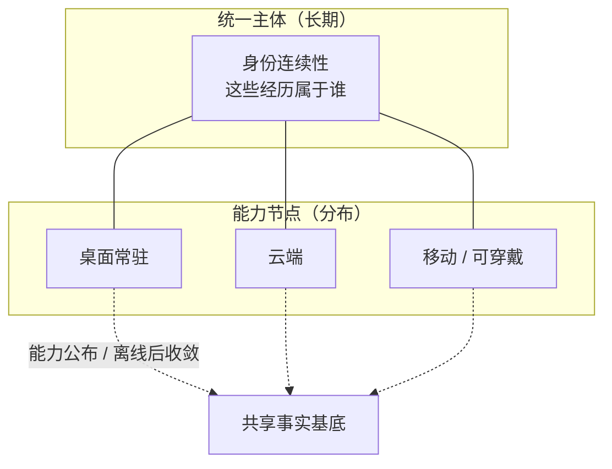
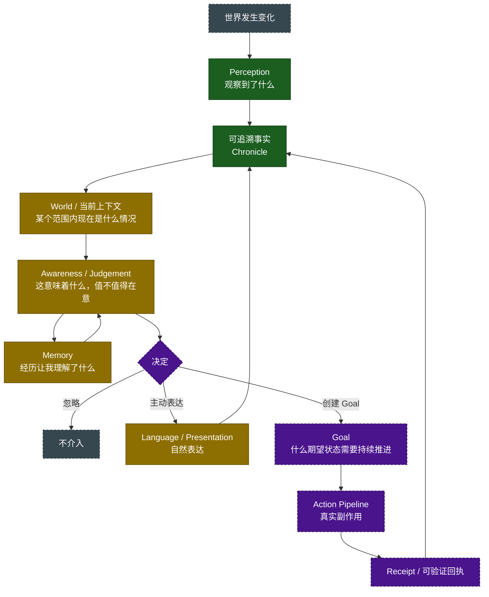

# Hikari 长期设计（Long-term Design）

> **状态**：长期方向 / 概览入口。**不是**冻结文档，**不是**实现记录。
>
> **权威**：本文**不产生 MUST**。按 `docs/architecture/governance-rules-v1.md` R2 与 `docs/architecture/plugin-design-spec.md` §18.2，MUST 只能来自 `principles.md`、`core-architecture-v0.md`，或 Runtime 已明确强制的不变量。本文出现的一切「应当 / 目标 / 方向」都是**长期意图**，其规范力来自它所引用的那两份文档，或根本不具有规范力。
>
> **层级**：本文位于 `docs/vision/`，与 `hikari-soul.md` 同级、同性质。它**不取代**、**不修改** `principles.md`、`core-architecture-v0.md`、`plugin-design-spec.md`、`governance-rules-v1.md` 中的任何一条。
>
> **上游**：`docs/vision/hikari-soul.md`（北极星）、`docs/architecture/principles.md`（长期最高原则）、`docs/architecture/core-architecture-v0.md`（当前冻结核心结构）。
>
> **下游**：`docs/architecture/hikari-current.md` —— 今天的实际状态。**两份文档必须分开读**：本文说的是「打算成为什么」，那份说的是「今天是什么」。

---

## 0. 本文要解决的问题

Hikari 的文档现在已经分成四类，各有各的读者：

```text
soul.md              为什么存在            —— 不被实现便利反向定义
principles.md        长期最高原则          —— MUST 的来源之一
core-architecture-v0 当前冻结结构          —— MUST 的来源之一
phase reviews        历史证据              —— 不作为权威来源
development docs     阶段记录              —— 不作为权威来源
```

缺的是**一张长期的地图**：上面那些文档分别回答「为什么」「必须怎样」「现在冻结了什么」，但没有任何一份文档回答：

> **如果一切按计划发展，Hikari 最终会是一个什么样的系统，各部分在其中的位置是什么？**

本文补的是这张地图。它有两条硬约束：

1. **长期设计不等于当前已经实现。** 本文描述的多数环节今天**不存在**。哪里不存在、哪里只有一半，一律以 `hikari-current.md` 为准。
2. **不得凭空冻结具体实现。** 尚未形成完整设计裁决的部分，本文只标注为**长期方向**，说明它要解决什么问题、由谁拥有这个 concern，**不**规定接口、不规定数据结构、不规定时序。真正的冻结只能走 `core-architecture-v0.md` §13 的路径：先 Boundary Review，再修改冻结文档。

---

## 1. 长期主体：她是什么

### 1.1 持续存在，而不是等待被调用

`hikari-soul.md` §1–§2 给出第一关键词：**Presence**。这不是「常驻进程」这个工程事实，而是一条设计判据：

> **持续感知不是目的，恰当地决定何时介入才是目的。**

一个只在被提问时存在的系统，无论回答多好，都不满足这一条。因此长期架构必须允许存在**不只一个行为循环**（`principles.md` §13）：对话循环之外，还可以有感知循环、目标推进循环、维护与整理循环。它们并级协作，**不允许**出现必须接管所有行为的 Super Orchestrator。

### 1.2 身份连续性：为什么今天仍然是同一个 Hikari

`soul.md` §3 给出的问题是整个长期设计中最难的一条：

> **为什么今天仍然是同一个 Hikari？**

答案不能是「某个进程还活着」「某个对象还在内存里」「某段 Prompt 还一样」。长期方向是把身份落在**可追溯的长期材料**上：事实史、已确认的决定、关系与承诺、以及从经历中形成的理解。模型可以换、设备可以换、入口可以换，这些东西不换。

这里有一条今天就已经生效的边界（`core-architecture-v0.md` §6.1）：**Continuity 回答「这些经历属于谁」，不负责 Memory、World、Goal、设备认证或权限判断。** Continuity 拥有的是身份与生命线的连续性，不是内容。

### 1.3 一个主体，多个节点

`core-architecture-v0.md` §0 的两句话是长期结构的浓缩：

> **统一的是「我」，分布的是观察、判断与行动。**
>
> **共享事实，不共享控制。**

未来的 Hikari 可能同时运行在云端、桌面常驻、手机、可穿戴设备上。这些**不是多个 Hikari**，而是同一个连续存在的多个能力节点（`principles.md` §16：跨设备应视为能力联邦）。



节点上线时公布能力，离线时依赖它的能力按生命周期收敛，而不是让上层持有失效对象。**v0 不实现这一层**：`core-architecture-v0.md` §10 已把跨 Runtime Service、远程 Event、跨节点事实同步、节点身份与撤销明确延后，触发条件是「真实实现已经出现无法被当前模型正确表达的问题」。

---

## 2. 目标认知闭环

`soul.md` §11 把 Hikari 的本体写成一条循环。下面是它在长期设计中的完整形态——**每一格标注今天的真实状态**（图例见下；状态依据 `hikari-current.md`）：



图例：**实线深绿** = 今天已实现并验证；**实线深黄** = 部分实现（有真实代码，但覆盖面或可靠性尚未成立）；**虚框深灰** = 长期规划；**虚框紫色** = 关键环节今天**完全不存在**。

必须如实读这张图的三件事：

1. **闭环今天没有闭上。** 从「判断」到「行动」到「回执」再回到事实的整条右支**不存在**：没有任何一条真实副作用经过统一治理链，因为 Action Pipeline 本身还没有被建立。
2. **「决定」这一格今天是空的。** 今天不存在的不是「判断能力」，而是「一处**拥有**介入决定的 owner」。已有的 Attention 是**逐场景的、各自独立的**能力，不是中央判断器。
3. **左支也不是闭合环。** Perception → Chronicle → World 是真实存在的；从 World 回到「值得在意的理解」这条边只有部分实例（见 `hikari-current.md`）。

---

## 3. 各环节的长期定位

以下每一节回答同一个问题：**这个 concern 属于谁，它要解决什么问题，今天到了哪一步。** 不规定实现形态。

### 3.1 Perception

**定位**：只回答「观察到了什么」。**不**决定这件事意味着什么、值不值得介入。

这条边界是 MUST 级的，来源是 `principles.md` §1 与 §14；`plugin-design-spec.md` §2.4 进一步要求平台知识由拥有该平台的 Plugin 持有，不得泄漏进平台中立的契约。

**长期要覆盖的观察面**：前台与输入活动、窗口与显示、日程与通知、消息、设备与网络状态、代码仓库与 CI、文件与项目变化。今天的实际覆盖面远小于此，见 `hikari-current.md`。

### 3.2 World

**定位**：回答「在**某个范围内**，现在是什么情况」。

**长期方向**（`core-architecture-v0.md` §6.3 已冻结的部分）：World **不是** `GlobalWorldState`。它是多个**有范围、有来源、有新鲜度、有不确定性**的局部视图。`core-architecture-v0.md` §11 把 GlobalWorldState 列为明确禁止重新引入的结构。

**今天已经成立的形状**：新 concern 的既有做法是**新建一个独立的 World Plugin**，而不是给既有 World 加字段（`repository-ci-world` 与 `desktop-session-world` 是两个独立 Plugin）。

### 3.3 Awareness 与 Judgement

**定位**：回答「这件事意味着什么，值不值得在意」。

**必须与 Perception 分开**，理由见 `principles.md` §14：把 Foreground、Calendar、DeviceActivity 这类传感器集合本身称为完整 Awareness 是范畴错误。

**长期方向**：判断是**局部活动**，发生在各自拥有该 concern 的循环内部。`core-architecture-v0.md` §6.6 已经冻结：**不建立中央 Judgement Domain**。

**今天最需要小心的一处张力**：已有若干「在什么条件下应当说话」的判断分散在不同 Plugin 里。它们在**语义上**各自属于自己那份感知的消费者，合起来却读起来像一套未被命名的统一判据。长期方向不是把它们合并成一个中央判断器，而是让「谁拥有介入决定」这件事在每一处都写清楚（`governance-rules-v1.md` R4 的四条问题正是用来判断这种边界是否被越过的）。

### 3.4 神经系统在整体系统中的位置

「神经系统」是 Hikari 用来称呼**从感知到理解这一段的结果架构**的名字。

**它明确不是 Central Brain。** 这一条不是本文的发明，而是既有冻结的直接推论：`core-architecture-v0.md` §11 禁止「中央 AI Brain」「中央 Judgement」「Super Orchestrator」「统一通信层」；`principles.md` §17 把「Central AI Brain」列为必须防止的章鱼化形态之一。

在长期设计中，神经系统应当具备的性质是：

```text
把分散的观察整理成可以被理解的东西
  —— 而不是把所有观察集中到一个决定全局的地方

保留来源与不确定性
  —— 而不是把不同来源压成一个「当前世界状态」

让每个 concern 可以各自判断
  —— 而不是替它们统一判断
```

**今日状态**：`docs/architecture/hikari-nervous-system-stage-v0.md` 定义了这个阶段的**边界与目标**（它自己声明为 stage 定义，不是实现授权，且 `:60-61` 明写「Nervous System 是**阶段视角**，不是组件」）。神经系统**今天没有被实现成一个组件**——它今天的载体是已存在的若干 Perception Plugin、它们的 World、以及它们各自的消费者。长期方向里它究竟是一个 Plugin、一组契约、还是一种组织约定，**尚未裁决**（见 §6）。

该阶段自己给出的完成判据是**行为性的，不是结构性的**：

> **读侧不再为零。** 至少有一个生产 Plugin 读取**它自己的**过去，并因此行为不同。

这条判据值得单独读：它把「神经系统完成了没有」从「建了多少组件」改成了「有没有人真的在读自己的过去」。第一阶段的研究 `docs/architecture/experience-formation-v0-research.md` 给出的结论是 `VERDICT = NARROW`，其核心判断是：

> **一条写了但没被读过的 Experience，与一条 Durable Fact 无法区分。因此 Experience Formation 不是一个存储问题，是一个「谁读自己的过去」的问题。**

### 3.5 Experience Formation

**定位**：回答「发生了什么经历，它构成了什么」。

这是 `soul.md` §6「通过共同经历真正发生变化」的机制化。与 `Chronicle` 的区别是根本性的：

```text
Chronicle        = 发生过什么（事实，可追溯，不可被解释覆盖）
Experience       = 从这段发生里，形成了什么（可修订）
Memory           = 这些经验让我理解了什么（可修订、可废弃）
```

**长期方向**：经历的形成需要**时间尺度**与**筛选**，不能等于「把事件流全部存下来」。`docs/architecture/experience-formation-v0-research.md` 是这一块的现行研究，结论为 `VERDICT = NARROW`，并自带解锁条件：**出现一个真实 bounded consumer，它的职责无法只靠 current facts 完成**。它给出问题与对照，**不构成实现授权**。

**今日状态**：不存在独立的 Experience Formation 组件。

### 3.6 Memory 与 Reactivation

**定位**：Memory 回答「过去的经历让我理解了什么」。它是**解释**，不是绝对真源（`principles.md` §12）。它**不等于** Chronicle。

**长期方向**：记忆必须可修订、可降低置信度、可合并、可废弃，并且尽量保留来源、依据、时间、置信度与修订关系。**Reactivation** 是其中的一条能力：让过去形成的理解在当下重新参与判断，而不是每次从零重新推导。

**两条今天就已经生效的边界**：

- 记忆的写入不能由模型解释自动获得（模型生成的解释不等于已核实事实）；
- 「检索过去说过的话」不等于 Memory——那更接近 Chronicle 查询。

**今日状态**：Memory Reactivation v0 已按 `docs/architecture/memory-reactivation-v0-boundary-review.md` 判为 **BLOCKED**；今天存在的是 Chronicle 侧的读取路径，不是 Memory 组件。详见 `hikari-current.md`。

### 3.7 Fast Cognition 与复杂推理

**定位**：Hikari 需要在**不同代价档位**上思考。多数时刻她做的是低代价判断（「这个变化值得在意吗」）；少数时刻需要昂贵的多步推理。

**长期方向**：

- 便宜的判断负责**过滤**，昂贵的推理负责**处理被过滤剩下的**；
- 昂贵推理的触发条件应当是**真实的、可被回看的**，而不是模型自己觉得重要；
- 两者共用同一套事实与权限边界：**便宜不等于可以乱说，昂贵不等于获得权限**。

**明确不做**：不建立一个「Model Router / Central Brain」来统一决定谁来思考。`CLAUDE.md` 与 `core-architecture-v0.md` §11 的禁止清单里都有这条。多模型在长期是**能力的多个 Provider**，不是 Hikari 的大脑分区。

**今日状态**：今天只有一条语言路径（一个模型 Provider，一次调用，可选的原生 tool use）。没有分层，也没有路由。

### 3.8 Language 与自然表达

**定位**：`principles.md` §15 已冻结：**Presentation 独占最终自然语言表达**。领域模块输出结构化事实、判断、结果与错误，不自行向用户说话。

**长期方向**：

```text
Domain Result  →  Language / Presentation  →  RenderedMessage  →  Transport
```

两条长期约束：

1. **事实与解释必须可区分。** 一个人读到的必须能分清哪些是系统读回来的事实、哪些是模型说的话。这条在今天的 Grounded Synthesis 里已经有具体落点（见 `hikari-current.md` §Grounded Synthesis），长期方向是把它做成**语言层的一般性质**，而不是某一个回答形状的特例。
2. **模型的语言不是 Hikari 的证词。** 说「我记得」「我已经做了」时，背后必须有可验证的对应物（`soul.md` §8、`principles.md` §9 的 Receipt 一等公民）。

### 3.9 Proactivity 与 Attention

**定位**：`soul.md` §5 给出的定义：

> **主动性不是「多做事」，而是「能够在正确的时候自己决定是否应该做事」。**

**长期方向**：主动性需要同时具备发现机会、判断是否值得介入、理解当前权限、在需要时请求确认、在不该行动时克制。`soul.md` §2 的那句同样适用：**理想状态不是不断刷存在感，而是「一直在场，但只在值得的时候出现」。**

**今天已经成立的两条经验**（来自既有实践，不构成对所有场景的要求）：

- 「来源报告了新变化」不等于「这件事值得打扰人」——把二者合并会让系统变得喧闹；
- 「可以说话」与「应该说话」是两次不同的判断，必须分别写下。

**今日状态**：存在**逐场景**的主动介入能力，各自独立、各自带自己的判据。**不存在**统一的 Attention 判据、优先级或预算。

### 3.10 Goal / Agency / Forge

**定位**：`core-architecture-v0.md` §6.5 已冻结 Goal 的边界：**Goal 表示长期承诺，不负责自己查询世界、自己决策下一步、自己执行动作。**

**长期形态**：

```text
观察 → 理解 → 判断 → 形成 Goal → 经过 Action 治理 → 执行 → 验证 → 新事实 → 再理解
```

其中：

- **Agency** 的目标不是无限权限，而是**可验证、可约束、可审计**的行动能力（`soul.md` §7）；
- **所有**改变外部现实的动作必须走统一行动边界，并留下 Receipt（`principles.md` §8、§9）；
- **Forge**（把「形成并推进工程/实现任务」这类长期工作做成一个自治过程）是这个方向上的一个**具体形态**，不是必需组件。

**今日状态**：Goal、Action Pipeline、Receipt **全部不存在**。今天没有任何一条真实副作用经过统一治理链——因为目前也没有需要治理的副作用。

---

## 4. 事实、推论、权限与可信的长期边界

这一节是本文最接近「约束」的部分，但它的规范力**全部来自被引用的上位文档**。

### 4.1 四层必须分开

```text
事实     来源报告了什么；发生过什么           Chronicle 拥有
推论     从事实中解释出了什么                 Memory / Judgement 拥有
表达     用自然语言对人说什么                 Presentation 拥有
权限     允许对现实做什么                     Action 治理拥有
```

今天已经生效的一条：**Perception 记录 source 报告了什么，不替现实做判断。**

### 4.2 权限单调收缩

`principles.md` §7：可见能力集合 ∩ Scope 限制 ∩ Authority Policy ∩ Safety Guard ∩ User Approval = 最终可执行集合，且**一个有约束力的拒绝不能被后来的普通 Allow 覆盖**。

`principles.md` §5 同时冻结：**能力存在 ≠ 能力暴露 ≠ 权限允许 ≠ 真实执行**，这四层不得合并成一个布尔开关。

**长期方向**：随着行动能力增长，这套收缩链必须**先于**能力建立，而不是事后补上。

### 4.3 模型不是 Hikari

`soul.md` §9 列出的区分在长期设计中必须一直成立：

```text
Runtime   = 她在哪里、以什么机制运行
模型       = 她用什么能力思考
记忆       = 她能保留和重建什么理解
表达       = 她如何表达自己
Provider  = 她现在能做什么
Transport = 她从哪接收和发送信息
连续性     = 为什么今天仍然是同一个 Hikari
```

**以上任何一项都不是 Hikari 本身。** 模型尤其不是：它是**实现材料**，不是架构层。

### 4.4 可信是架构属性

`soul.md` §8 的一句话在长期是硬要求：

> **可信不是人格要求，而应该成为架构属性。**

它有三个方向上的落点：说的和存的必须对得上（事实层）、说的和知道的必须分得开（解释层）、说的和做过的必须证得了（行动层）。

---

## 5. 分布式的长期方向

### 5.1 Plugin 是唯一扩展单元

`core-architecture-v0.md` §3 与 `plugin-design-spec.md` §1 已冻结：Runtime 只认识一种 Plugin，**禁止**业务 Plugin 基类树（AgentPlugin / SensorPlugin / AwarenessPlugin / LoopPlugin / MemoryPlugin …）。Provider / Consumer / Loop / Perception / World / Awareness / Memory / Goal / Presentation 都只是**领域角色**。

### 5.2 四种通信平面，长期不合并

```text
需要一种能力        → Service
某件事刚刚发生      → Event
未来必须能证明发生过 → Chronicle / Durable Fact
要改变外部现实      → Action Pipeline
```

`core-architecture-v0.md` §4 已冻结：**Hikari 没有万能通信层、万能消息对象或统一通信信封。**

### 5.3 多设备的长期形态

跨设备是**能力联邦**：节点公布能力、离线收敛，上层不持有失效对象。跨节点的一致性、身份与撤销、离线信任窗口等问题在 `core-architecture-v0.md` §10 被明确延后，等待真实实现问题驱动。

### 5.4 多模型的长期形态

多模型是**同一能力契约的多个 Provider**（`principles.md` §4）。选择策略只在真实领域需求出现后，由相应领域承担；**Runtime 不发展成全局业务调度器**（`core-architecture-v0.md` §5.4）。

---

## 6. 长期方向中尚未形成裁决的问题

以下问题**本文不给出答案**，也不得被后续实现顺手默认掉。它们需要真实需求驱动的一次 Boundary Review / Human 裁决：

| # | 问题 | 为什么不能由本文决定 |
| --- | --- | --- |
| 1 | 神经系统最终是一种**组织约定**，还是一组**契约**，还是一个 **Plugin**？ | 决定它就要决定一个新的公共面；`plugin-design-spec.md` §16 要求先有真实交互语义 |
| 2 | Hikari 是**一个主体多个循环**，还是**一个主体多个节点多个循环**？两者的连续性模型不同 | 触及 Continuity 的语义，属架构级 |
| 3 | Experience / Memory 的**写入权**：谁有权把一次经历升级成记忆？ | 触及「模型解释不等于已核实事实」这条边界的执行方式 |
| 4 | 主动介入的**总量控制**（预算 / 优先级 / 静默期）由谁拥有？ | 属于 `governance-rules-v1.md` R4 的 Q4：人类与 source 都还没给出的事 |
| 5 | Goal 与 Action 的**初始权限模型**：第一版允许做什么、谁批准 | 触及 `principles.md` §7 的收缩链，必须先于实现 |
| 6 | Forge 是一个独立自治过程，还是 Goal 的一种形态？ | 尚无真实实现问题驱动 |
| 7 | 跨设备第一批节点是什么、共享什么 | `core-architecture-v0.md` §10 明确延后 |

**判定规则**：这些问题里，只要有任何一个开始阻塞真实实现，正确动作是**先做 Boundary Review**，而不是在代码里顺手决定。

---

## 7. 与当前的关系

```text
本文（长期）        这份文档说的是打算成为什么
hikari-current.md   那份说的是今天实际是什么
```

两份文档**都必须**与下面四份权威文档一起读，且不得与它们冲突：

```text
docs/architecture/principles.md             长期最高原则
docs/architecture/core-architecture-v0.md   当前冻结核心结构
docs/architecture/plugin-design-spec.md     Plugin 设计与 code review 操作规范
docs/architecture/governance-rules-v1.md    冻结语义 / 权威层级 / 评审级别
```

**历史评审**（`docs/architecture/phase-*` 与各 `*-boundary-review.md`）是**证据**，不是第三个活跃的设计层。它们记录当时的事实与裁决；被取代的条目由修订指针连接，正文保持原貌（`governance-rules-v1.md` R7.2）。
